### BLOKZİNCİR TEMELLERİ
## İP-01 · Blokzincir ve Ortak Kayıt

### Blokzincir, işlem, blok ve dağıtık defter

**İşlem**, ağın işlemesi için gönderilen bir eylemdir. Örneğin bir kullanıcı akıllı sözleşmeye etkinlik kaydı gönderebilir. **Blok**, bir grup işlemi ve ilgili protokol bilgilerini içerir. Her blok önceki bloğa onun kriptografik özetiyle (**hash**) bağlanır. Geçmiş veriyi değiştirmek özetleri değiştirir. Değiştirilmiş bir geçmişin ağ tarafından kabul edilip edilmeyeceğini protokolün uzlaşma ve kesinleşme kuralları belirler.

**Dağıtık defter**, kayıtların birden fazla düğümde tutulduğu ve ağ üzerinden eşitlendiği sistemdir. Blokzincir, kayıtları birbirine bağlı bloklar hâlinde düzenleyen bir dağıtık defter türüdür. Düğümlerin tuttuğu veri ve üstlendiği görev, ağın tasarımına ve düğüm türüne bağlıdır.

### Merkezi veritabanı ile kayıt ve güven farkı

Merkezi veritabanında yazma ve güncelleme yetkisini sistemi işleten kurum belirler. Kullanıcı, erişim kurallarının ve yedekleme süreçlerinin düzgün işletildiğine güvenir. Blokzincirde düğümler işlemleri protokol kurallarına göre doğrular ve hangi geçmişin geçerli olduğu konusunda ağın konsensüs mekanizmasını izler. Kayıt yetkisi ve karar ölçütü ağa göre değişir. Örneğin doğrulayıcıların oy ağırlığı kullanılan stake’e bağlı olabilir.

### Geçmiş işlem kaydı ve güncel sözleşme durumu

Geçmiş işlem kaydı, hangi işlemin ne zaman gerçekleştiğini gösterir. Sözleşmenin güncel durumu ise başarılı işlemlerden sonra geçerli olan değerleri gösterir. Örneğin bir katılımcının takma adı sözleşme izin veriyorsa yeni bir işlemle değişebilir. Önceki kayıt ve sonraki güncelleme, zincir geçmişinde ayrı işlemler olarak görülebilir.

### Etkinlik kaydında yarar ve ek maliyet

Organizatör ve katılımcı, başarılı kaydı ve giriş durumunu ortak bir kaynaktan denetleyebilir. Sözleşme aynı adresin ikinci kez kaydolmasını veya bir kaydın ikinci kez girişte kullanılmasını engelleyebilir. QR kodu yine kopyalanabilir. Tekrar kullanımı önlemek için giriş sırasında kaydın durumunu kontrol etmek ve giriş işlemini yetkili biçimde işaretlemek gerekir.

Cüzdan kurulumu, işlem ücreti, zincir onayı için bekleme ve açık verinin mahremiyet etkisi bu yaklaşımın maliyetleri arasındadır. Küçük bir etkinlikte bu maliyetler kayıtların ortak bir ağda doğrulanmasından elde edilen faydayı aşabilir.

**Benim yorumum.** Kayıtları tek bir organizatör yönetiyorsa, hatalı kayıtları kolayca düzeltmem gerekiyorsa veya katılımcı bilgilerinin erişimini sınırlamak istiyorsam normal bir veritabanını tercih ederim.

## İP-2

Node ve Konsensüs

# Node ve validator nedir? Her node blok üretir mi?

Node (Düğüm): Blokzincir ağına bağlanan ve ağ yazılımını çalıştıran bir bilgisayar veya yazılım örneğidir. Tam düğüm (full node), aldığı işlemleri ve blokları ağın kurallarına göre kendi başına kontrol eder. Geçerli verileri diğer düğümlere iletebilir ve zincirin güncel durumunu takip eder.

Validator (Doğrulayıcı): PoS gibi sistemlerde, protokolün kurallarına göre yeni blok öneren veya önerilen bloklar için oy veren katılımcıdır. Örneğin Ethereum'da bir doğrulayıcı, sıra kendisine geldiğinde blok önerir. Diğer zamanlarda hangi bloğu geçerli gördüğünü oyuyla bildirir.

KISACA: Her node blok üretmez. Tam düğüm kendisine gelen bloğu kontrol edebilir. Yeni blok üretme görevini PoW'da madenciler, PoS'ta ise protokolün seçtiği doğrulayıcılar üstlenir.

# Konsensüs neyi sağlar? PoW ve PoS’un temel yaklaşımları nasıl farklılaşır?

Konsensüs (Uzlaşma): Ağdaki düğümlerin hangi geçerli blok geçmişini esas alacağını belirleyen kuralların tümüdür. Örneğin iki farklı blok aynı anda önerildiğinde düğümler bu kuralları kullanarak hangi zinciri takip edeceklerini belirler. Böylece aynı para iki farklı kişiye gönderilmeye çalışıldığında ağ ortak işlem sırasını esas alır.

• PoW (Proof of Work / İş İspatı): Madenciler, ağın belirlediği koşulu sağlayan bir blok özeti (hash) bulmak için çok sayıda deneme yapar. Uygun özeti bulan madenci bloğunu ağa yayınlar. Bitcoin'de düğümler geçerli zincirler arasından toplam iş miktarı en yüksek olanı takip eder.

• PoS (Proof of Stake / Hisse İspatı): Doğrulayıcılar ağda görev almak için protokolün istediği miktarda varlığı teminat olarak yatırır. Protokol blok önerecek doğrulayıcıyı seçer ve diğer doğrulayıcıların oylarını değerlendirir. Bazı kural ihlallerinde doğrulayıcı yatırdığı teminatın bir kısmını kaybedebilir.

KISACA: PoW hesaplama gücüne ve harcanan işe dayanır. PoS teminata ve doğrulayıcıların oylarına dayanır.

# Public/private ve permissionless/permissioned ağ ne demektir?

Public (Halka Açık) / Private (Özel): Ağdaki kayıtları kimlerin görebildiğini anlatır. Halka açık bir ağda zincir üzerindeki kayıtlar herkes tarafından incelenebilir. Özel bir ağda kayıtları görme erişimi belirli kişi veya kurumlarla sınırlandırılabilir.

Permissionless (İzinsiz) / Permissioned (İzinli): Belirli bir görevi yapmak için bir kurumdan veya ağ yöneticisinden önceden onay gerekip gerekmediğini anlatır. İzinsiz bir ağda protokolün koşullarını sağlayan katılımcılar ilgili göreve başkalarından onay almadan katılabilir. İzinli bir ağda ilgili yetki, onaylanan katılımcılara verilir.

İzinleri Üç Ayrı Soruyla Düşünebiliriz:

1. Okuma: Blokları ve işlem kayıtlarını kim inceleyebilir?
2. İşlem Gönderme: Ağa kim yeni işlem iletebilir? Örneğin herkes kayıtları okuyabilir ama ağa işlem göndermek için bir kurumun onayladığı kullanıcı hesabı gerekebilir.
3. Doğrulayıcı Olma: Kim blok önerebilir veya konsensüse oyuyla katılabilir? Örneğin işlem göndermek tüm üyelere açıkken doğrulayıcı olma yetkisi belirli kurumlara verilebilir.

----KRİTİK NOT----

Bir ağın kayıtları halka açık olabilir ve doğrulayıcıları izinle seçilebilir. Ayrıca ağa işlem gönderebilmek, akıllı sözleşmedeki her işlemi yapabilme yetkisi vermez. Örneğin herkes etkinlik sözleşmesine işlem gönderebilse bile sözleşme, bilet basma yetkisini organizatörle sınırlayabilir.

# İşlemin bloğa alınması, başarılı çalışması ve kesinleşmesi neden farklıdır?

1. Bloğa Alınması: İşlem bir bloğun içine yazılır ve o blok ağın o anda takip ettiği zincire eklenir. İşlem artık blokta görülebilir.
2. Başarılı Çalışması: İşlem, ağın yürütme kurallarına göre hata vermeden tamamlanır ve işlemde yapılan değişiklikler uygulanır. Örneğin Ethereum'da bilet almak için işlem gönderdim ama biletler tükenmişse sözleşme işlemi geri çevirebilir. Bu durumda işlem blokta görünür ve işlem ücreti harcanabilir, ancak bilet bana geçmez.
3. Kesinleşmesi (Finality): İşlemin bulunduğu bloğun geçmişte kalıcı hale gelmesiyle ilgilidir. Bitcoin'de bloğun üzerine yeni bloklar eklendikçe işlemin zincirden çıkma olasılığı azalır. Ethereum'da ise protokol, yeterli doğrulayıcı oyu toplandığında ilgili blok geçmişini kesinleşmiş sayar.

KISACA: Bloğa alınma işlemin kayda girdiğini, başarılı çalışma işlemin sonucunu, kesinleşme ise kaydın zincirde kalıcılığını anlatır.

# Benim yorumum: Tek bir node kapanınca bütün ağ durur mu?

Bence burada bakmam gereken ilk şey, kapanan node'un ağda hangi görevi yaptığı ve kalan düğümlerin o görevi sürdürebilip sürdüremediğidir. Normal bir tam düğüm kapanırsa diğer düğümler işlemleri ve blokları paylaşmaya devam edebilir. Ama bir doğrulayıcı kapanırsa, ağın ilerleyebilmesi kalan doğrulayıcıların yeterli oy gücüne sahip olmasına bağlıdır. Örneğin küçük bir izinli ağda tek bir doğrulayıcının kapanması gereken oy eşiğinin altına düşülmesine yol açarsa, ağ yeni blokları kesinleştiremeyebilir.

Etkinlik uygulamam yalnızca kapanan node'a bağlanıyorsa kullanıcılar işlem gönderemeyebilir. Diğer düğümler çalıştığı sürece ağ ilerleyebilir. Bu durumda hem ağdaki doğrulayıcıların nasıl dağıldığına hem de uygulamanın ağa hangi düğümler üzerinden bağlandığına bakarım.

## İP-3

Kriptografi ve Cüzdan

# Hash, şifreleme ve dijital imza hangi farklı amaçlarla kullanılır?

Hash (Özet): Bir veriden sabit uzunlukta bir özet üretir. Aynı veri aynı özeti verir. Verinin bir kısmı değişirse özet de genellikle değişir. Böylece bir kaydın değişip değişmediğini kontrol edebilirim. Güvenli bir hash fonksiyonunda özetten yola çıkarak asıl veriyi bulmak pratikte çok zordur.

Şifreleme (Encryption): Veriyi gizlemek için kullanılır. Örneğin cüzdan uygulamam cihazda sakladığı özel anahtarı şifreleyebilir. Uygulama, parolamdan türettiği anahtarla bu şifreyi çözebilir.

Dijital İmza (Digital Signature): Bir işlemin ilgili özel anahtar kullanılarak yetkilendirildiğini ve imzalanan içeriğin değişmediğini doğrulamaya yarar. Örneğin biletimi başka bir adrese devretmek istediğimde cüzdanım işlemi özel anahtarımla imzalar. Ağ, açık anahtar üzerinden imzayı doğrulayabilir.

KISACA: Hash veri bütünlüğünü kontrol etmeye yarar. Şifreleme veriyi gizler. Dijital imza, işlemin yetkisini ve içeriğinin bütünlüğünü doğrulamaya yarar.

# Private key, public key, adres, mnemonic ve seed arasındaki ilişki nedir?

Private Key (Özel Anahtar): Hesabımdan işlem imzalamamı sağlayan gizli değerdir. Bu anahtara sahip olan biri benim hesabım adına işlem imzalayabilir.

Public Key (Açık Anahtar): Özel anahtardan matematiksel olarak türetilir ve imza doğrulamak için kullanılır. Açık anahtardan özel anahtarı hesaplamak pratikte mümkün değildir.

Adres (Address): Ağa göre belirli kurallarla oluşturulan hesap tanımlayıcısıdır. Örneğin Ethereum'da anahtarla kontrol edilen bir hesabın adresi, açık anahtarın özetinden türetilir. Birinin bana token gönderebilmesi için adresimi bilmesi yeterlidir.

Mnemonic (Kurtarma Kelimeleri): Cüzdanın ürettiği rastgele veriyi, belirli sıradaki kelimelerle temsil eder. Cüzdanı kurtarırken kelimelerin sırası önemlidir.

Seed (Tohum): BIP39 kullanan bir cüzdanda kurtarma kelimelerinden ve varsa ek paroladan üretilen sayısal değerdir. Cüzdan bu değeri kullanarak birden fazla hesabın anahtarını türetebilir. [BIP39](https://bips.dev/39/) · [BIP32](https://bips.dev/32/)

İlişkinin Çalışma Sırası:

1. Cüzdan rastgele bir başlangıç verisi üretir ve bu veriden kurtarma kelimelerini oluşturur.
2. Kurtarma kelimelerinden ve kullanıldıysa ek paroladan seed üretilir.
3. Seed'den hesapların özel anahtarları, her özel anahtardan da ilgili açık anahtar türetilir.
4. Ethereum'da açık anahtardan hesabın adresi elde edilir.

# Entropi ve checksum ne işe yarar? BIP39, BIP32 ve BIP44 hangi aşamalarla ilgilidir?

Entropi (Entropy): Başlangıç verisinin ne kadar tahmin edilemez olduğunu anlatır. Örneğin cüzdan 12 kurtarma kelimesi oluşturmak için 128 bit rastgele veriyle başlar. Bu verinin güvenli bir rastgele sayı üretecinden gelmesi, kelimelerin tahmin edilmesini zorlaştırır. [BIP39](https://bips.dev/39/)

Checksum (Kontrol Toplamı): Başlangıç verisinin hash'inden alınan ve veriye eklenen kısa kontrol bilgisidir. Cüzdan, kelimeleri girerken yapılan bazı yazım veya sıralama hatalarını bu bilgiyle fark edebilir. [BIP39](https://bips.dev/39/)

• BIP39: Rastgele veri ve kontrol toplamından kurtarma kelimelerinin nasıl oluşturulduğunu, bu kelimelerden seed'in nasıl üretildiğini tarif eder. [BIP39](https://bips.dev/39/)
• BIP32: Aynı seed'den bir anahtar ağacının nasıl türetildiğini tarif eder. Bu ağaç sayesinde cüzdan, aynı başlangıç bilgisiyle aynı hesap anahtarlarını tekrar oluşturabilir. [BIP32](https://bips.dev/32/)
• BIP44: BIP32 anahtar ağacında para birimi, hesap ve adres sırası gibi bilgilerin hangi seviyelerde tutulacağını tarif eder. Cüzdan, aradığı hesabın anahtarına bu türetme yolunu izleyerek ulaşır. [BIP44](https://bips.dev/44/)

----KRİTİK NOT----

Kurtarma kelimeleri kontrol toplamından geçse bile doğru cüzdana ait olmayabilir. Aynı kelimelerle farklı bir BIP39 ek parolası kullanırsam farklı bir seed elde ederim. Eski adreslerimi yeniden bulmak için kullandığım türetme yolunun da aynı olması gerekir. [BIP39](https://bips.dev/39/) · [BIP32](https://bips.dev/32/)

# Cüzdan uygulaması ile hesap aynı şey midir? Adresi paylaşmakla anahtarı paylaşmak neden farklıdır?

Cüzdan Uygulaması: Hesaplarımı görmemi, anahtarlarımı yönetmemi ve işlem imzalamamı sağlayan yazılımdır. Tek bir uygulamadan birden fazla hesabı yönetebilirim.

Hesap: Ağda adresiyle tanınır. Bakiye ve işlem kayıtları ağda tutulur. Uyumlu başka bir cüzdan uygulamasıyla aynı hesabı tekrar kullanabilirim.

Adresimi Paylaşmak: Birinin bana token göndermesini sağlar. Halka açık bir ağda bu adresi bilen kişi bakiyemi ve adresle ilişkili işlem geçmişini inceleyebilir. Örneğin etkinlik için kullandığım adresi adımla birlikte paylaşırsam, aynı adresle yaptığım başka işlemler de benimle ilişkilendirilebilir.

Özel Anahtarımı Paylaşmak: Anahtarı alan kişi hesabımdan işlem imzalayabilir ve varlıkları başka bir adrese gönderebilir. Kurtarma kelimelerimi ve varsa ek parolamı bilen biri, bunlardan türetilen birden fazla hesabın anahtarına ulaşabilir.

KISACA: Adres, hesabı bulmak ve hesaba varlık göndermek için kullanılır. Özel anahtar, hesap adına işlem yapma yetkisi verir.

# Benim yorumum: Cüzdan uygulamasının silinmesiyle kurtarma bilgisinin kaybolması arasında ne fark var?

Bence burada önemli olan, hesabım adına işlem imzalayabilecek bir kopyaya hâlâ erişip erişemediğimdir. Cüzdan uygulamamı silersem zincirdeki bakiyem ve işlem geçmişim durur. Kurtarma kelimelerim ve varsa ek parolam elimdeyse, uyumlu bir uygulamada aynı türetme yoluyla hesaplarımı yeniden açabilirim. Cüzdana dışarıdan eklediğim bir hesap varsa, o hesabın özel anahtarını ayrıca yedeklemem gerekir.

Kurtarma bilgimi kaybettiysem ama cüzdanım hâlâ işlem imzalayabiliyorsa, varlıklarımı kurtarma bilgisini sakladığım yeni bir hesaba taşıyabilirim. Kurtarma bilgisiyle birlikte çalışan son cüzdanı ve özel anahtarın diğer kopyalarını da kaybedersem, hesabı zincirde görmeye devam ederim ama hesabımdan işlem yapamam.

## İP-4

Bitcoin, Ethereum ve Token

# Bitcoin ve Ethereum’un temel amaçları ve programlanabilirliği nasıl farklılaşır?

Bitcoin: Araya bir banka veya ödeme kuruluşu girmeden kişiden kişiye dijital para gönderebilmek için tasarlanmıştır. Bitcoin Script ile bir ödemenin hangi koşullarda harcanabileceği belirlenebilir. Örneğin para, iki kişinin de imzası olduğunda harcanabilir. [Bitcoin teknik makalesi](https://bitcoin.org/bitcoin.pdf) · [Bitcoin işlem belgeleri](https://developer.bitcoin.org/devguide/transactions.html)

Ethereum: Varlık transferinin yanında ağ üzerinde akıllı sözleşmeler çalıştırmak için tasarlanmıştır. Örneğin etkinlik sözleşmesi kaç bilet kaldığını takip edebilir, yeni kayıtları kabul edebilir ve kontenjan dolduğunda kayıt işlemini geri çevirebilir. [Ethereum teknik belgeleri](https://ethereum.org/developers/docs/intro-to-ethereum/)

KISACA: Bitcoin Script ile paranın hangi koşullarda harcanacağını tanımlayabilirim. Ethereum'da akıllı sözleşmelerle etkinlik kaydı gibi bir uygulamanın kurallarını ve güncel durumunu zincir üzerinde yönetebilirim.

# Native varlık ve token nedir? ETH ile USDC arasındaki fark nedir?

Native Varlık (Ağın Yerel Varlığı): Bakiyesi ve transferi doğrudan ağın protokolü tarafından yönetilen varlıktır. ETH, Ethereum'un yerel varlığıdır ve işlem ücretleri (gas) ETH ile ödenir. Bitcoin ağının yerel varlığı ise BTC'dir. [Ethereum ETH belgeleri](https://ethereum.org/what-is-ether/) · [Bitcoin teknik makalesi](https://bitcoin.org/bitcoin.pdf)

Token: Ethereum'da bakiyesi ve transfer kuralları bir akıllı sözleşme tarafından yönetilen dijital varlıktır. Örneğin Ethereum'daki USDC bakiyemi USDC sözleşmesi tutar. Cüzdanımdan doğrudan USDC gönderdiğimde karşı tarafa USDC gider, bu işlemin ağ ücretini ise ETH ile öderim. [Circle USDC](https://www.circle.com/usdc) · [ERC-20](https://eips.ethereum.org/EIPS/eip-20) · [Ethereum ETH belgeleri](https://ethereum.org/what-is-ether/)

# Stablecoin, NFT ve ERC-20 kavramları neyi ifade eder?

• Stablecoin: Değerini bir referans varlığa yakın tutmayı amaçlayan tokendır. Örneğin USDC, 1 ABD doları değerini hedefler. [Circle USDC](https://www.circle.com/usdc)

• NFT (Non-Fungible Token): Her birimi ayrı ayrı tanımlanabilen tokendır. Örneğin 15 numaralı koltuğun biletiyle 16 numaralı koltuğun bileti ayrı kimliklere sahip olabilir. Ethereum'da ERC-721, bu tür tokenlar için kullanılan standartlardan biridir. [ERC-721](https://eips.ethereum.org/EIPS/eip-721)

• ERC-20: Birimleri birbirinin yerine geçebilen tokenlar için Ethereum'da kullanılan bir standarttır. Cüzdanların bir hesabın token bakiyesini sorgulayabilmesi ve token gönderebilmesi için ortak bir arayüz tanımlar. Ethereum'daki USDC bu standardı kullanır. [ERC-20](https://eips.ethereum.org/EIPS/eip-20) · [Circle USDC](https://www.circle.com/usdc)

KISACA: Stablecoin değer hedefini, NFT her birimin ayrı bir kimliği olduğunu, ERC-20 ise birbirinin yerine geçebilen tokenlarla uygulamaların nasıl işlem yapacağını anlatır. USDC hem bir stablecoin hem de Ethereum'da bir ERC-20 tokendır.

# Mainnet ve testnet neden ayrılır? Test ETH ve test USDC aynı ekonomik değeri taşır mı?

Mainnet (Ana Ağ): Gerçek ekonomik değeri olan varlıkların ve uygulamaların kullanıldığı üretim ağıdır. Burada yaptığım bir transfer ve ödediğim işlem ücreti, ana ağdaki bakiyemi etkiler. [Ethereum ağ belgeleri](https://ethereum.org/developers/docs/networks/)

Testnet (Test Ağı): Uygulamaları ana ağdaki varlıkları riske atmadan denemek için kullanılan ayrı bir ağdır. Örneğin Sepolia'da test ETH ile gas ödeyebilir, test USDC ile bir bilet ödeme akışını deneyebilirim. Cüzdan adresim iki ağda aynı olsa bile bakiyeler ve işlem geçmişi ayrı tutulur. [Ethereum ağ belgeleri](https://ethereum.org/developers/docs/networks/) · [Circle test ağı musluğu](https://faucet.circle.com/)

----KRİTİK NOT----

Test ETH, ana ağdaki ETH ile aynı ekonomik değeri taşımaz. Test USDC de ana ağdaki USDC gibi 1 ABD doları karşılığı olan bir varlık değildir. Test ağında gördüğüm bakiye, deneme işlemleri için kullanılır. [Ethereum ağ belgeleri](https://ethereum.org/developers/docs/networks/) · [Circle test ağı musluğu](https://faucet.circle.com/)

# Benim yorumum: Etkinliğe giriş hakkını temsil etmek için mutlaka token gerekir mi?

Bence giriş hakkını temsil etmek için token şart değil. Akıllı sözleşmede hangi adreslerin kayıtlı olduğunu tutabilirim. Katılımcı kapıda bir mesaj imzalayarak o adresi kontrol ettiğini gösterebilir. Görevli de kaydın geçerli olup olmadığını ve daha önce kullanılıp kullanılmadığını kontrol edebilir. Kayıtları tek bir organizatör yönetiyorsa aynı işi normal bir veritabanı ve ilk kullanımda geçersiz kılınan bir QR koduyla da yapabilirim.

Eğer her biletin ayrı bir kimliği olsun ve katılımcılar biletlerini cüzdanlarında görüp başka birine devredebilsin istiyorsam NFT kullanmayı düşünürüm. Karar verirken biletin devredilmesine ihtiyaç var mı ve giriş hakkını kimlerin doğrulaması gerekiyor diye bakarım.

## İP-5

Akıllı Sözleşme ve ABI

# Akıllı sözleşme, EVM ve state nedir?

Akıllı Sözleşme (Smart Contract): Blokzincirde bir adrese yayınlanan ve çağrıldığında kodundaki kuralları uygulayan programdır. Örneğin etkinlik sözleşmesi kayıt isteği geldiğinde boş yer olup olmadığını kontrol eder ve yer varsa katılımcının adresini kaydeder.

EVM (Ethereum Virtual Machine): Ethereum düğümlerinin sözleşme kodunu aynı kurallarla çalıştırmak için kullandığı sanal makinedir. Düğümler aynı başlangıç durumu ve aynı işlemlerle aynı sonucu hesaplar.

State (Durum): Ağın o andaki durumunu gösterir. Hesap bakiyeleri ve sözleşmelerin kalıcı olarak tuttuğu değerler bunun parçasıdır. Örneğin sözleşmede kaç kişinin kayıtlı olduğu ve hangi adreslerin giriş hakkı bulunduğu, sözleşmenin güncel durumuna dahildir. [Ethereum EVM belgeleri](https://ethereum.org/developers/docs/evm/)

# Kaynak kod, derleme ve bytecode nasıl ilişkilidir? Deploy ne yapar?

1. Kaynak Kod: Etkinlik kurallarını Solidity gibi bir dilde yazdığım, insanın okuyabildiği koddur.
2. Derleme: Derleyici kaynak kodu EVM'in çalıştırabileceği komutlara çevirir. Bu komutların bayt olarak gösterimine bytecode denir. Derleyici, yayınlama için gereken oluşturma bytecode'unu ve çağrılar için kullanılacak ABI gibi çıktıları üretir.
3. Deploy (Yayınlama): Sözleşme oluşturma işlemini ağa gönderirim. İşlem başarılı olursa oluşturma kodu çalışır, varsa constructor başlangıç ayarlarını yapar ve çalıştırma bytecode'u yeni sözleşme adresinde saklanır. Sonraki çağrıları bu adrese gönderirim. [Solidity derleyici belgeleri](https://docs.soliditylang.org/en/latest/using-the-compiler.html) · [Ethereum akıllı sözleşme belgeleri](https://ethereum.org/developers/docs/smart-contracts/)

# ABI ne işe yarar? Ne zaman elde edilir? Adres dışında hangi bilgilere ihtiyaç duyarım?

ABI (Application Binary Interface): Uygulamanın sözleşmeyle hangi biçimde konuşacağını tarif eden arayüzdür. Örneğin frontend, kayıt sorgulayan fonksiyonun bir adres beklediğini ve sonuç olarak doğru veya yanlış döndürdüğünü ABI'den öğrenir. Gönderilecek çağrı verisini bu bilgiyle kodlar ve dönen sonucu çözer.

ABI'nin JSON biçimi derleme sırasında üretilebilir. Bu yüzden sözleşme daha yayınlanmadan ABI elimde olabilir. Yayınlanmış ve kaynak kodu doğrulanmış bir sözleşmenin ABI'sini blok gezgininden de edinebilirim.

• Fonksiyonlar: Çağıracağım fonksiyonun adı, parametrelerin sırası ve türleri, dönen değerin türü ve fonksiyonun ETH kabul edip etmediği.
• Olaylar (Events): Örneğin bir kayıt olayını ekranda göstereceksem olayın adı ve alanlarının türleri.
• Ağ Bilgisi: Adresin hangi ağda kullanıldığını da bilmem gerekir. Örneğin Sepolia'daki etkinlik sözleşmesine ulaşmak için uygulamamı Sepolia'ya bağlarım. [Solidity ABI belgeleri](https://docs.soliditylang.org/en/latest/abi-spec.html) · [Ethereum ağ belgeleri](https://ethereum.org/developers/docs/networks/)

KISACA: Ağ ve adres, çağrıyı nereye göndereceğimi gösterir. ABI, çağrıyı nasıl hazırlayacağımı ve gelen veriyi nasıl okuyacağımı gösterir.

# Veri okumak ile state değiştiren işlem göndermek nasıl ayrılır?

Veri Okumak: Örneğin kaç boş yer kaldığını bir `view` fonksiyonuyla sorgularım. Uygulama bir node'a `eth_call` isteği gönderir ve sonucu alır. Bu çağrı için cüzdanla işlem imzalamam veya ağ ücreti ödemem gerekmez. Zincire yeni işlem yazılmaz.

State Değiştirmek: Etkinliğe kayıt olmak için cüzdanımla bir işlem imzalar ve ağa gönderirim. İşlem bloğa alınıp başarıyla çalışırsa sözleşmenin kalıcı durumu güncellenir. Bu işlem için gas harcanır. [Ethereum JSON-RPC belgeleri](https://ethereum.org/developers/docs/apis/json-rpc/)

# Kaynak kodu verify etmek neyi doğrular? Güvenlik denetimiyle aynı şey midir?

Kaynak Kod Doğrulama (Verify): Yayınlanan kaynak kodun, ilgili derleyici sürümü ve ayarlarıyla derlendiğinde zincirdeki bytecode ile eşleştiğini kontrol eder. Böylece blok gezgininde gördüğüm kaynak kodu inceleyip o adreste hangi kuralların çalıştığını anlayabilirim. [Ethereum kaynak kod doğrulama belgeleri](https://ethereum.org/developers/docs/smart-contracts/verifying/)

Güvenlik Denetimi (Audit): Sözleşmenin davranışını ve güvenlik açıklarını inceler. Örneğin kontenjan kontrolü doğru mu, yetkisiz bir kişi etkinliği iptal edebilir mi veya bir kayıt iki kez kullanılabilir mi diye bakılır.

----KRİTİK NOT----

Doğrulanmış bir sözleşmede de hata olabilir. Verify, kaynak kod ile zincirdeki kodun eşleştiğini gösterir. Audit, bu kodun nasıl davrandığını inceler. [Ethereum kaynak kod doğrulama belgeleri](https://ethereum.org/developers/docs/smart-contracts/verifying/)

# Benim yorumum: Aynı kod iki farklı adrese yayınlanınca kayıtları neden ayrı olabilir?

Bence burada kodla kayıtları ayrı düşünmek gerekiyor. Aynı etkinlik sözleşmesini iki farklı adrese yayınlarsam, her adresin kendi kalıcı depolama alanı olur. Birini cumartesi, diğerini pazar etkinliği için kullanabilirim. Cumartesi sözleşmesine bir katılımcı eklediğimde o adresteki kayıt listesi değişir. Pazar sözleşmesi kendi listesini kullanmaya devam eder.

Uygulamamda iki sözleşme için de aynı ABI'yi kullanabilirim. Hangi etkinliğin kaydını okuyacağımı veya güncelleyeceğimi, çağrıyı gönderdiğim sözleşme adresi belirler.

###  AĞ ERİŞİMİ, İŞLEMLER VE EKOSİSTEM

## İP-6

RPC, Explorer ve Event

Amaç: Uygulamanın zincirdeki bilgiye nasıl eriştiğini anlamak.

# RPC ve RPC endpoint nedir? Node ve RPC hizmet sağlayıcısı ile ilişkileri nasıldır?

RPC (Remote Procedure Call / Uzak Yordam Çağrısı): Uygulamamın bir node'dan belirli bir işlem yapmasını veya bilgi vermesini isteme yöntemidir. Örneğin Ethereum'da son blok numarasını öğrenmek için `eth_blockNumber`, sözleşmeden boş yer sayısını okumak için `eth_call` isteği gönderebilirim. İmzalanmış bir işlemi de RPC üzerinden ağa iletebilirim. [Ethereum JSON-RPC belgeleri](https://ethereum.org/developers/docs/apis/json-rpc/)

RPC Endpoint (RPC Erişim Adresi): Uygulamanın bu istekleri gönderdiği adrestir. Node, ağla iletişim kurar ve zincir verisine erişir. Kendi node'umu çalıştırıp onun RPC adresini kullanabilirim. Bir RPC hizmet sağlayıcısı da kendi altyapısındaki node'lara erişmem için bana bir endpoint sunabilir. [Ethereum JSON-RPC belgeleri](https://ethereum.org/developers/docs/apis/json-rpc/)

# Block explorer nedir? Explorer’ın veya bir RPC adresinin kapanması ağın durduğunu gösterir mi?

Block Explorer (Blok Gezgini): Blokları, işlemleri, adresleri ve sözleşme kayıtlarını tarayıcıdan incelememi sağlayan bir arayüzdür. Örneğin bir kayıt işleminin hash'ini aratarak hangi bloğa alındığını ve başarılı olup olmadığını görebilirim. [Ethereum blok gezgini belgeleri](https://ethereum.org/developers/docs/data-and-analytics/block-explorers/)

----KRİTİK NOT----

Explorer kapanırsa o site üzerinden kayıtları görüntüleyemem. Uygulamamın kullandığı RPC adresi kapanırsa uygulamam o bağlantı üzerinden veri okuyamaz veya işlem gönderemez. Diğer node'lar çalıştığı ve ağın ilerlemesi için gereken koşullar sağlandığı sürece ağ yeni blok üretmeye devam edebilir. Bunu kontrol etmek için aynı ağdaki bağımsız bir RPC adresinden blok numarasının zamanla ilerleyip ilerlemediğine bakabilirim. [Ethereum JSON-RPC belgeleri](https://ethereum.org/developers/docs/apis/json-rpc/)

# Event/log ile sözleşmenin güncel state’i nasıl ayrılır? Indexer ne işe yarar?

Event (Olay) ve Log (Olay Kaydı): Sözleşme bir işlem sırasında olay yayınlayabilir. Örneğin bir katılımcı kaydolduğunda sözleşme `KayitYapildi` olayı yayınlarsa, katılımcının adresi gibi olay bilgileri işlemin makbuzunda bir log olarak yer alır. [Solidity ABI belgeleri](https://docs.soliditylang.org/en/latest/abi-spec.html#events) · [Ethereum JSON-RPC belgeleri](https://ethereum.org/developers/docs/apis/json-rpc/)

Güncel State (Durum): Sözleşmenin şu anda geçerli olan değerleridir. Örneğin bir katılımcı daha sonra kaydını iptal ederse önceki kayıt olayı işlem geçmişinde durur. Güncel durumu sorguladığımda o adres için aktif kayıt olmadığını görebilirim.

Indexer (İndeksleyici): Blok ve olay kaydı gibi zincir verilerini toplar, işler ve kolay sorgulanabilecek şekilde saklar. Örneğin bir yönetim ekranında son kayıtları ve iptalleri listelemek için her seferinde baştan log taramak yerine indeksleyicinin hazırladığı veriyi sorgulayabilirim. İndeksleyici son blokları henüz işlemediyse ekrandaki liste kısa süreliğine geriden gelebilir. [The Graph belgeleri](https://thegraph.com/docs/en/subgraphs/overview/)

KISACA: Log geçmişte hangi olayın yayınlandığını, state ise şu anda hangi durumun geçerli olduğunu gösterir. Indexer, zincirdeki verileri sorgulamayı kolaylaştırır.

# Benim yorumum: Explorer olmadan bir kaydı kontrol etmek için hangi yolu araştırırdım?

Bence önce neyi kontrol etmek istediğime bakarım. Sepolia'da kayıt işleminin yapılıp yapılmadığını öğrenmek istiyorsam, aynı ağa bağlı bir RPC adresine işlem hash'ini verip `eth_getTransactionReceipt` ile işlem makbuzunu sorgularım. Makbuz geldiyse işlemin başarı durumuna ve etkinlik sözleşmesinin beklediğim kayıt olayını yayınlayıp yayınlamadığına bakarım.

Katılımcının şu anda giriş hakkı olup olmadığını öğrenmek istiyorsam, sözleşmenin adresini ve ABI'sini kullanarak kayıt sorgulama fonksiyonunu `eth_call` ile çağırırım. Böylece geçmişte kayıt yapılmış olsa bile sonradan iptal edilen bir kaydı kapıda geçerli saymam. [Ethereum JSON-RPC belgeleri](https://ethereum.org/developers/docs/apis/json-rpc/)

## İP-7

Bir İşlemin Yolculuğu

Amaç: İmza ile zincirdeki sonuç arasındaki aşamaları anlamak.

# Cüzdan bağlamak, mesaj imzalamak ve işlem göndermek hangi farklı işlemlerdir?

Cüzdan Bağlamak: Uygulamanın cüzdanımla iletişim kurmasına ve izin verdiğim hesap adresini görmesine olanak verir. Örneğin etkinlik sayfası hangi adresle bağlandığımı görür ve mevcut kaydımı sorgulayabilir. [Ethereum cüzdan sağlayıcısı standardı](https://eips.ethereum.org/EIPS/eip-1193)

Mesaj İmzalamak: Özel anahtarımı kullanarak bir mesajı onaylarım. Örneğin kapıda görevlinin verdiği tek kullanımlık mesajı imzalayarak kayıtlı adresi kontrol ettiğimi gösterebilirim. Mesaj imzası tek başına zincire işlem yazmaz ve gas harcamaz. Bazı imzalar ise sonradan bir sözleşmede kullanılabilecek harcama izni gibi yetkiler verebilir.

İşlem Göndermek: Örneğin etkinliğe kaydolmak için sözleşmeye gidecek işlemi cüzdanımla imzalarım. İmzalanan işlem bir RPC adresi üzerinden ağa iletilir. Ağ işlemi bloğa alıp çalıştırdığında başarılı olursa kayıt durumu değişebilir. [Ethereum işlem belgeleri](https://ethereum.org/developers/docs/transactions/)

# Gas limit, gas used, işlem ücreti, nonce ve chain ID ne işe yarar?

• Gas Limit: İşlemin kullanmasına izin verdiğim en fazla gas miktarıdır. Gas, ağın yaptığı hesaplama işini ölçer. İşlem bu sınırın altında tamamlanırsa kullanılmayan gas için ücret ödemem.
• Gas Used: İşlemin yürütülmesinde kullanılan ve işlem makbuzunda görülen gas miktarıdır.
• İşlem Ücreti: Ethereum'da normal bir sözleşme çağrısı için kullanılan gas miktarı ile gas başına gerçekleşen fiyatın çarpımıdır. Ücret ETH ile ödenir. İşlem bloğa girip başarısız çalışırsa da harcanan gas için ücret ödenir. [Ethereum gas belgeleri](https://ethereum.org/developers/docs/gas/)
• Nonce: Gönderen hesabın o ağdaki işlem sıra numarasıdır. Ağ aynı hesaptan gelen işlemleri bu sıraya göre işler. Böylece aynı sıradaki işlem zincirde iki kez uygulanmaz.
• Chain ID: İşlemin hangi zincir için imzalandığını belirten ağ kimliğidir. Örneğin Sepolia için imzalanan işlemin Ethereum ana ağında aynı imzayla kullanılmasını engellemeye yardımcı olur. [Ethereum işlem belgeleri](https://ethereum.org/developers/docs/transactions/) · [EIP-155](https://eips.ethereum.org/EIPS/eip-155)

# Txid/transaction hash, sözleşme adresi ve block hash neyi tanımlar?

• Txid / Transaction Hash (İşlem Özeti): İmzalanmış işlemi tanımlayan değerdir. Kayıt işlemini sorgulamak için bu değeri kullanırım.
• Sözleşme Adresi: İşlemi gönderdiğim veya verisini okuduğum sözleşme hesabını tanımlar. Aynı sözleşmeye birden fazla işlem gönderebilirim.
• Block Hash (Blok Özeti): Belirli bir bloğu tanımlar. Bir blok birden fazla işlem içerebilir. [Ethereum JSON-RPC belgeleri](https://ethereum.org/developers/docs/apis/json-rpc/)

# Pending, receipt ve status nedir? İşlem hash’i neden tek başına başarı kanıtı değildir?

Pending (Beklemede): İşlem ağa gönderilmiş ve henüz bir bloğa alınmamış olabilir. Bu aşamada sonucu gösteren işlem makbuzu henüz yoktur.

Receipt (İşlem Makbuzu): İşlem bloğa alındığında sorgulayabildiğim sonuç kaydıdır. İşlemin hangi bloğa girdiğini, ne kadar gas kullandığını ve hangi log'ları ürettiğini içerir.

Status (İşlem Durumu): Ethereum işlem makbuzunda `1` işlemin başarıyla çalıştığını, `0` ise yürütmenin başarısız olduğunu gösterir. Kayıt işleminin sonucunu görmek için makbuzun durumuna ve gerekiyorsa sözleşmenin log'larına veya güncel durumuna bakarım. [Ethereum JSON-RPC belgeleri](https://ethereum.org/developers/docs/apis/json-rpc/)

----KRİTİK NOT----

İşlem hash'i imzalanan veriden hesaplanabilir. Bu nedenle elimde hash olması, işlemin ağa ulaştığını, bloğa girdiğini veya başarıyla çalıştığını tek başına göstermez. Makbuz görmem işlemin bir bloğa alındığını gösterir. Kesinleşmeyi ayrıca kontrol ederim.

# İmzadan sonuç kontrolüne işlem akış şeması

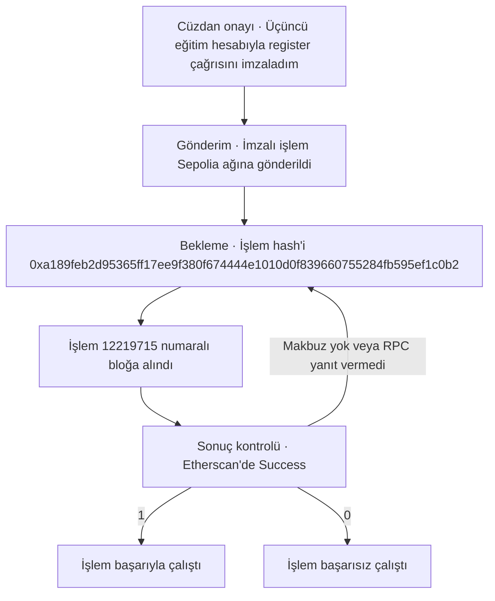

Şemada İP-16’daki üçüncü eğitim hesabımla yaptığım tam ad-soyad kaydını kullandım. Etherscan’de blok numarası `12219715` ve işlem durumu `Success` görünüyor. Bu durum makbuzda `status = 1` anlamına gelir. [Sepolia Etherscan işlem kaydı](https://sepolia.etherscan.io/tx/0xa189feb2d95365ff17ee9f380f674444e1010d0f839660755284fb595ef1c0b2)

# Benim yorumum: “İşlem başarısız” ile “sonucunu öğrenemedim” neden farklıdır?

Bence aradaki fark, elimdeki kanıt. Makbuzda `status = 0` görürsem işlemin bloğa girdiğini ve çalışırken başarısız olduğunu bilirim. Örneğin kontenjan dolduğu için kaydım kabul edilmemiş olabilir.

RPC isteğim zaman aşımına uğradıysa veya makbuz henüz gelmediyse sonucu bilmiyorum. İşlem bekliyor olabilir ya da ben sorgularken kullandığım bağlantı kesilmiş olabilir. Kaydı tekrar göndermeden önce aynı ağdaki başka bir RPC üzerinden elimdeki hash'i sorgularım.

## İP-8

Ekosistemi Tanı

Amaç: İleri alanların hangi ihtiyaca cevap verdiğini görmek.

# Web3, L1/L2, DeFi, DAO, oracle, bridge ve ZK nedir?

• Web3: Kullanıcıların cüzdanlarıyla bağlanabildiği ve bazı işlemlerin blokzincir üzerinde yürütüldüğü uygulamaları kapsayan genel bir kavramdır. Örneğin bir etkinlik sayfasına cüzdanımla bağlanıp zincirdeki kaydımı sorgulayabilirim. [Ethereum Web3 rehberi](https://ethereum.org/web3/)
• L1 / L2 (Katman 1 / Katman 2): L1, Ethereum gibi kendi konsensüsüyle çalışan temel ağdır. L2, işlemleri temel ağın dışında işleyerek kapasiteyi artırmayı ve maliyeti azaltmayı amaçlar. Örneğin bir rollup birçok işlemi toplu işleyip sonuçlarını doğrulamak için Ethereum'u kullanır. [Ethereum L2 belgeleri](https://ethereum.org/layer-2/)
• DeFi (Merkeziyetsiz Finans): Takas ve borç verme gibi finansal işlemlerin akıllı sözleşmelerle yürütülmesidir. Örneğin bir takas uygulamasında cüzdanımdaki bir tokenı başka bir tokenla değiştirebilirim. [Ethereum DeFi rehberi](https://ethereum.org/defi/)
• DAO (Merkeziyetsiz Otonom Organizasyon): Bir topluluğun kararları ortak kurallarla aldığı organizasyon modelidir. Örneğin üyeler bütçenin hangi projeye ayrılacağına oy verebilir ve kararın uygulanması bir akıllı sözleşmeyle yönetilebilir. [Ethereum DAO rehberi](https://ethereum.org/dao/)
• Oracle: Zincir dışındaki bilgileri sözleşmenin kullanabileceği biçimde zincire taşıyan mekanizmadır. Örneğin bir borç verme sözleşmesi, teminatın güncel dolar değerini hesaplamak için oracle'dan fiyat verisi alabilir. [Ethereum oracle belgeleri](https://ethereum.org/developers/docs/oracles/)
• Bridge (Köprü): Ayrı zincirler arasında varlık veya mesaj aktarmaya yarar. Bir köprü, örneğin varlığı kaynak ağda kilitleyip hedef ağda onu temsil eden bir token oluşturabilir. [Ethereum köprü belgeleri](https://ethereum.org/developers/docs/bridges/)
• ZK (Zero-Knowledge Proof / Sıfır Bilgi Kanıtı): Bir iddianın doğru olduğunu, kanıtı oluştururken kullandığım özel veriyi açıklamadan göstermeme yarar. Örneğin doğum tarihimi göstermeden yaş şartını sağladığımı kanıtlayabilirim. [Ethereum ZK belgeleri](https://ethereum.org/developers/docs/scaling/zk-rollups/)

# Dijital kimlik, RWA ve DePIN nerede kullanılabilir?

Dijital Kimlik: Üniversitem bana doğrulanabilir bir öğrenci belgesi verir, ben de bunu öğrenci indirimi almak için kullanırım. Etkinliği düzenleyen kişi belgenin gerçekten üniversite tarafından verildiğini kontrol edebilir. [W3C Doğrulanabilir Belgeler standardı](https://www.w3.org/TR/vc-data-model-2.0/)

RWA (Real-World Assets / Gerçek Dünya Varlıkları): Zincir dışındaki bir varlığın veya varlığa bağlı bir hakkın zincirde temsil edilmesidir. Örneğin BlackRock'un BUIDL fonu, ABD Hazine bonoları gibi varlıklara yatırım yapan bir fonun paylarını token olarak temsil eder. [Securitize BUIDL duyurusu](https://securitize.io/learn/press/blackrock-launches-first-tokenized-fund-buidl-on-the-ethereum-network)

DePIN (Decentralized Physical Infrastructure Networks / Merkeziyetsiz Fiziksel Altyapı Ağları): Fiziksel altyapının farklı katılımcıların işlettiği cihazlarla sağlandığı ağlardır. Örneğin Helium'da katılımcılar erişim noktaları kurarak su sayacı gibi IoT cihazlarının kablosuz veri gönderebilmesine katkı sağlar. [Helium IoT belgeleri](https://docs.helium.com/iot/lorawan-on-helium/)

# ZK ile neyi kanıtlarım ve hangi bilgiyi saklayabilirim?

Örneğin yaş sınırı olan bir etkinliğe girmek istiyorum. Güvenilen bir kurumun imzaladığı dijital belgedeki doğum tarihimi kullanarak “18 yaş şartını sağlıyorum” iddiası için bir kanıt oluşturabilirim. Organizatör, kanıtın geçerli olduğunu kontrol eder. Doğum tarihim kanıtın özel girdisi olarak kalır.

----KRİTİK NOT----

ZK'nin hangi bilgiyi gizlediği, kanıtın ve uygulamanın nasıl tasarlandığına bağlıdır. Örneğin kanıt doğum tarihimi gizlerken işlemi gönderen cüzdan adresi zincirde açıkça görünebilir. Bazı ZK rollup'lar kanıtı işlem gruplarının kurallara uygun işlendiğini göstermek için kullanır ve işlem verilerinin bir kısmını herkese açık yayınlar. [Ethereum ZK rollup belgeleri](https://ethereum.org/developers/docs/scaling/zk-rollups/)

# Benim yorumum: Hangi alanı daha sonra öğrenmek isterim ve neden?

Ben dijital kimlik ve ZK konusunu daha sonra öğrenmek isterim. Etkinliğe girişte yaş veya öğrenci statüsü gibi bir koşulu kontrol etmem gerekebilir. Katılımcının doğum tarihini ya da öğrenci numarasını sistemde saklamadan, yalnızca giriş koşulunu sağladığını nasıl doğrulayabileceğimi merak ediyorum.

## İP-09 · Gerçek Bir Blokzincir Projesini İncele

### Seçtiğim proje — BiLira (TRYB)

BiLira’nın Türkiye’de geliştirdiği TRYB, Türk lirasına 1:1 oranında sabitlenmesi hedeflenen bir stabil kripto varlıktır (stablecoin). BiLira, dolaşımdaki her 1 TRYB için rezervde 1 TL tuttuğunu belirtir. TRYB, Ethereum ve Solana gibi mevcut blokzincirlerde çalışır. 

### Hangi problemi, kimler için çözüyor?

Bir banka hesabındaki TL bakiyesi doğrudan bir blokzincir cüzdanına gönderilemez veya bir akıllı sözleşmede kullanılamaz. TRYB, TL cinsinden değer taşımak isteyen bireylere aynı ağdaki cüzdanlar arasında transfer edebilecekleri bir token sunar. TRYB’yi destekleyen borsalar ve merkeziyetsiz finans (DeFi) uygulamaları da bu tokenı kendi sistemlerine entegre edebilir. [BiLira TRYB kullanım rehberi](https://www.bilira.co/tr/tryb-kullanimi)

### Zincir üzerinde ve zincir dışında neler yapılıyor?

- **Zincir üzerinde** TRYB oluşturulur, cüzdanlar arasında gönderilir ve gerektiğinde dolaşımdan çıkarılır (yakılır). Bu işlemler blokzincire kaydedilir.
- **Zincir dışında** BiLira kimlik doğrulaması yapar, bankalar TL yatırma ve çekme işlemlerini yürütür. TRYB’nin karşılığı olan TL rezervi banka hesaplarında tutulur. 

Örneğin bankamdan BiLira’ya TL gönderdiğimde bu işlem zincir dışında gerçekleşir. TRYB’yi kendi cüzdanımdan başka bir cüzdana gönderdiğimde ise transfer blokzincire kaydedilir.

### Neden blokzincir kullanıyor? Normal bir veritabanıyla ne değişirdi?

Blokzincir sayesinde kendi cüzdanımda tuttuğum TRYB’yi BiLira’nın uygulamasına giriş yapmadan aynı ağdaki başka bir cüzdana gönderebilirim. Alıcı da transferi blokzincir tarayıcısından doğrulayabilir. Aynı token, onu destekleyen akıllı sözleşmelerde de kullanılabilir. 

BiLira yalnızca merkezi bir veritabanı kullansaydı TL yatırma, çekme ve platform içi bakiye transferi yine yapılabilirdi. Bu durumda bakiye BiLira’nın tuttuğu bir hesap kaydı olurdu. Dış uygulamalar işlem yapmak veya kayıtları sorgulamak için BiLira’nın sunduğu bir arayüze ya da ayrı bir entegrasyona ihtiyaç duyardı. Platform içi transferlerde blokzincir işlem ücreti ortadan kalkardı.

### Kullanıcı kime, hangi konuda güveniyor?

- **BiLira’ya** dolaşımdaki TRYB’ye karşılık gelen TL rezervini tutması, token oluşturma yetkisini güvenli yönetmesi ve onaylanan TL çekimlerini gerçekleştirmesi konusunda güvenir. 

- **Bankalara ve bağımsız denetçilere** bankaların rezervi saklaması ve transferleri işlemesi, denetçilerin de rapor tarihindeki rezerv durumunu doğru raporlaması konusunda güvenir. Zincir kayıtları token hareketlerini gösterir. Bankadaki TL rezervi için başvurulan kaynak yayımlanan denetim raporlarıdır.

### Benim yorumum

**Güçlü tarafı.** Bence projenin en güçlü yanı, TL cinsinden bir değeri kendi cüzdanımda tutabilmem ve bir başkasına gönderdiğimde ikimizin de işlemi aynı açık kayıt üzerinden kontrol edebilmesi.

**Sınırlaması.** Bence en önemli sınırlama, TRYB’yi tekrar banka hesabımdaki TL’ye çevirebilmemin BiLira’nın rezervi tutmasına ve ödemeyi işlemesine bağlı olması. Cüzdanımdaki TRYB bakiyesini anlık görebilirim, ancak bankadaki karşılığını değerlendirmek için belirli tarihlerde yayımlanan raporlara bakmam gerekir.

## İP-10 · Blokzincir Yarışması Şartnamesini İncele

Kaynak olarak 20 Şubat 2026 tarihli **2026 TEKNOFEST Blokzincir Yarışması Teknik Şartnamesi (V1.1)** ve yarışma sayfasını kullandım. [Teknik şartname PDF’si](https://cdn.teknofest.org/media/upload/userFormUpload/2026_BLOKZ%C4%B0NC%C4%B0R_YARI%C5%9EMASI_%C5%9EARTNAMES%C4%B0_TR.20_02_rBh8h.pdf) · [Resmî yarışma sayfası](https://teknofest.org/tr/yarismalar/blokzincir-yarismasi/)

### Yarışmanın amacı ve kapsamı

2026 TEKNOFEST Blokzincir Yarışması, blokzincir altyapısını geliştiren veya bu teknolojiyi kamu yönetimi, eğitim, finans ve tedarik zinciri gibi alanlardaki gerçek sorunlara uygulayan projeler arıyor. Başvurunun aşağıdaki yedi ana temadan birine girmesi gerekiyor. 

- **Yüksek başarımlı ve ölçeklenebilir DLT altyapıları.** Ağ yoğunken işlem kapasitesini artırmak, farklı ağları birlikte çalıştırmak veya aynı değerin iki kez harcanmasını önlemek.
- **DLT sistemlerinde mahremiyet.** Dağıtık bir sistemde işlem veya kullanıcı verisinin hangi taraflara gösterileceğini kontrol etmek.
- **Dijital cüzdanlar.** İmzalama yetkisini güvenli yönetmek, erişim kaybında cüzdanı kurtarmak veya dijital kimlik ve varlığı bir arada kullanmak.
- **Blokzincir kriptolojisi.** Sıfır bilgi kanıtı gibi yöntemleri daha hızlı veya düşük maliyetli hâle getirmek ya da kuantum dayanıklı yöntemler geliştirmek.
- **Blokzincir güvenliği.** Akıllı sözleşme hatalarını otomatik tespit etmek ve ağ protokollerinin güvenliğini artırmak.
- **Kripto varlık regülasyon altyapıları.** Rezervlerin doğrulanmasını, zincir verilerinin analizini ve transferlerde gerekli bilgilerin paylaşılmasını desteklemek.
- **Seçilmiş DLT uygulama alanları.** Dijital kimlik doğrulama, ürünün kaynağını izleme, merkeziyetsiz finans, tokenizasyon veya Web3 geliştirici araçları gibi ihtiyaçlara çözüm üretmek.

### Quantum Team’in geçmişte hedeflediği kapsamlar

- **2025 — Kampüs Cüzdanım.** Takım bir dijital cüzdan ve ödeme sistemi geliştirdi. Proje, kampüs ölçeğinde ödeme kullanımına odaklanıyordu. Quantum, 2025 Blokzincir Yarışması’nda birinci oldu. 
- **2026 — HALOCLINE.** Takım kapsamı kafe, kampüs ve mağazalarda ödeme, sipariş ve sadakat işlemlerini bir araya getiren bir altyapıya genişletti. Takımın açıklamasına göre ödeme kayıtları kendi geliştirdiği Atlas L1 ağına yazılıyor ve sistem internet kesintisinde de ödeme almayı hedefliyor. Takım, yüksek başarımlı ve ölçeklenebilir DLT altyapıları kapsamında üçüncülük elde ettiğini duyurdu. 
- **Bu eğitimdeki hedef.** Depodaki README dosyası, Ethereum Sepolia üzerinde cüzdan bağlantısı ve akıllı sözleşme içeren bir etkinlik kayıt uygulaması geliştirmeyi hedefliyor. Bu uygulamada bir kaydı cüzdanla imzalamayı, zincire göndermeyi ve sonucu doğrulamayı deneyebiliriz.

### Başvuru ve beklenen çıktılar

Şartnameye göre takım, danışman hariç 2–5 kişiden oluşur. Ön lisans, lisans, yüksek lisans ve doktora öğrencileri ile mezuniyetinin üzerinden en fazla üç yıl geçmiş kişiler başvurabilir. Takım kaptanı ve iletişim sorumlusu belirlenir. Takım kaydı, üye davetleri ve proje başvurusu KYS üzerinden yürütülür. Projenin özgün olması ve aynı projeyle tek kategoriye veya yarışmaya başvurulması gerekir. 
- **Başvuru** (28 Şubat). KYS’de takım kaydı ve proje başvurusu
- **Ön değerlendirme** (27 Mart, 17.00 · Puan ağırlığı %10). Proje Ön Değerlendirme Raporu. Ön elemede konu ve rapor düzeni de kontrol edilir.
- **Proje raporu** (26 Haziran, 17.00 · Puan ağırlığı %15). Proje Sunum Raporu. Varsa projenin kaynak kodu da hakemlerce incelenir.
- **Çevrim içi sunum** (Özet 10 Temmuz, sunum 20–25 Temmuz · Puan ağırlığı %15). Özet Proje Sunum Raporu teslim edilir ve takım belirlenen saatte projesini sunar.
- **Final** (Resmî yarışma sayfasında 30 Eylül–4 Ekim, Şanlıurfa Havalimanı · Puan ağırlığı %60). Finale kalan takım projesini jüriye sunar.

Raporlar resmî şablonlara uygun hazırlanır ve KYS’ye yüklenir. PDF’nin takviminde “Yarışma Finalleri” için Ağustos–Eylül, festival için 30 Eylül–4 Ekim yazıyor. Resmî yarışma sayfası 30 Eylül–4 Ekim aralığını final tarihi olarak listeliyor.

**Prototip.** Şartnamenin puanlama tablosunda prototip için ayrı bir teslim tarihi veya puan kalemi yer almıyor. Çalışan bir demo, uygulanabilirliği göstermek için kullanılabilir. Örneğin etkinlik uygulamasında bir katılımcının cüzdanla kayıt oluşturması, işlem sonucunun blokzincir tarayıcısında görülmesi ve ikinci kaydın sözleşme tarafından reddedilmesi gösterilebilir.

### Jüri projeyi hangi ölçütlerle değerlendiriyor?

- **Katma değer ve yenilikçilik.** Çözüm mevcut yöntemlere göre hangi somut faydayı sağlıyor?
- **Teknoloji kullanımı.** Seçilen teknoloji soruna nasıl hizmet ediyor ve çözüm yeni ihtiyaçlara uyarlanabilir mi?
- **Uygulanabilirlik.** Proje mevcut kaynaklarla çalıştırılabilir mi ve bir ürüne dönüşme potansiyeli var mı?
- **Yaygın etki.** Çözüm kimlere ulaşabilir ve hangi toplumsal, ekonomik ya da sektörel faydayı sağlayabilir?
- **Sürdürülebilirlik.** Finansman, bakım, çevresel ve sosyal etkiler ile uzun vadeli riskler nasıl ele alınacak?

Bu beş ölçüt proje içeriğine uygulanır. Yüzdeler ise değerlendirme aşamalarının toplam puandaki ağırlığını gösterir.

### Şartnamede geçen bazı kavramlar

- **DLT ve ölçeklenebilirlik.** DLT, işlem kayıtlarının bir ağdaki birden fazla katılımcı tarafından tutulmasını sağlayan teknolojilerin genel adıdır. Ölçeklenebilirlik, kullanıcı ve işlem sayısı arttığında sistemin kabul edilebilir hız ve maliyetle çalışmayı sürdürebilmesidir.
- **MPC (çok taraflı hesaplama).** Birden fazla taraf kendi gizli girdilerini açıklamadan ortak bir hesaplama yapar. Cüzdanda bu yöntem, tek bir tarafın tam özel anahtarı elinde tutmasına gerek kalmadan ortak imza üretmek için kullanılabilir.
- **Rezerv kanıtı (PoR).** Bir kurumun rezerv olarak tuttuğunu söylediği varlıkları doğrulamaya yönelik yöntemlerdir. İP-09’daki BiLira örneğinde TRYB işlemleri zincirden izlenebilir. Bankadaki TL rezervi hakkında ise bilgi denetim raporlarından gelir.
- **Travel Rule.** FATF standartlarındaki bu kural, kapsama giren kripto varlık transferlerinde gönderici ve alıcıya ilişkin belirli bilgilerin ilgili hizmet sağlayıcılar arasında iletilmesini öngörür.
- **Sıfır bilgi kanıtı (ZK).** Bir bilginin ayrıntılarını açıklamadan bir koşulu sağladığını kanıtlamayı mümkün kılar. Örneğin bir öğrenci, öğrenci numarasını paylaşmadan geçerli bir öğrenci belgesine sahip olduğunu kanıtlayabilir.

### Benim yorumum

Bence yarışmada en çok akıllı sözleşme yazmayı ve test ağında işlem yapmayı öğrenmek işime yarar. Örneğin sunumda cüzdanımla bir etkinliğe kayıt olup kaydın blokzincire işlendiğini gösterebilirim. Böylece jüri projenin nasıl çalıştığını görebilir.

## B · Uygulama İçin Çalışma Ortamı

### İP-11 · Çalışma Ortamını Hazırla

**Önceden hazırladıklarım**

- Bilgisayarımda Visual Studio Code ve Git zaten kuruluydu. [Visual Studio Code indirme sayfası](https://code.visualstudio.com/download) · [Git for Windows indirme sayfası](https://git-scm.com/install/windows)
- `quantum-baslangiic` klasörüm ve ona bağlı `hykmett/quantum-baslangic` GitHub depom zaten vardı. Projemin amacını ve öğrenmek istediğim konuları `README.md` dosyasına yazmıştım. Araştırma notlarımı da depoya eklemiştim.
- Git kullanıcı adımı ve e-posta adresimi daha önce ayarlamıştım. İlk commit’imi de oluşturmuştum. GitHub’daki `main` dalının yerel kopyasında README dosyamı ve araştırma notlarımı gördüm.

**Bu iş paketinde yaptıklarım**

- Çalışma ortamımı kontrol ettim ve bu özeti araştırma notlarıma ekledim. Son değişikliklerimi commit edip GitHub’a göndermem gerekiyor.

**Kısa kavramlar**

- **Git** ile dosyalarımdaki değişiklikleri ve proje geçmişimi takip ederim.
- **GitHub**’da projemi çevrim içi saklayabilir ve ekibimle paylaşabilirim.
- **README** dosyasında projemin amacını ve nasıl kullanılacağını anlatırım.
- **Commit** ile seçtiğim değişiklikleri bir mesajla yerel Git geçmişime kaydederim.
- **Push** ile yerelde kaydettiğim commit’leri GitHub’daki depoma gönderirim.

**4. MetaMask**

- MetaMask tarayıcı uzantısını kurdum. İP-13’te uygulamanın ürettiği eğitim hesabını ayrı bir tarayıcı profilinde içe aktardım. [MetaMask’in resmî indirme sayfası](https://metamask.io/download)

**5. Remix IDE ve Solidity**

- Remix’i tarayıcıda açtım. Solidity dosyası oluşturmak için **File Explorer → New File** seçeneğini kullandım. [Remix IDE](https://app.remix.live/)
- Remix IDE, tarayıcıda akıllı sözleşme yazmak, derlemek ve denemek için kullandığım geliştirme ortamıdır. Solidity ise Ethereum’da çalışan akıllı sözleşmeleri yazdığım programlama dilidir.

**6. Ek araçlar ve README**

- Bilgisayarımda Node.js ve npm’in zaten kurulu olduğunu kontrol ettim. Remix’i tarayıcıda kullanmak için bunlara ihtiyacım yok. Uygulamam paket veya bir geliştirme sunucusu gerektirirse Node.js ve npm’i kullanacağım.

### Benim yorumum

Bu iş paketinde benim için yeni olan araç MetaMask’ti. Tarayıcı uzantısını kurdum ve hesabımı oluşturdum. VS Code, Git, Node.js ve npm bilgisayarımda zaten vardı. Remix’in resmî adresini buldum ve Solidity dosyası oluşturmak için hangi menüyü kullanacağımı öğrendim.

## İP-12 · Kendi Cüzdan Oluşturucunu Yaz

Uygulamamda **Yeni eğitim cüzdanı oluştur** düğmesine bastığımda tarayıcı `crypto.getRandomValues` ile 16 bayt (128 bit) entropi üretiyor. ethers.js ile bu veriyi 12 İngilizce kelimeye ve boş ek parolayla seed’e dönüştürüyorum. Seed’den `m/44'/60'/0'/0/0` yolundaki özel anahtarı türetiyorum. Özel anahtardan açık anahtarı, açık anahtardan da Ethereum adresini hesaplıyorum. Ekranda her adımın sonucunu ve kullanılan çağrıyı ayrı ayrı görebiliyorum. Hassas değerleri görmek için **Göster** düğmesine basıyorum.

BIP39 referans vektöründe `TREZOR` ek parolasıyla beklenen kelimelerin ve seed’in aynısını elde ettim. Ayrıca boş ek parolayla bilinen bir test hesabının özel anahtarını ve Ethereum adresini doğruladım.

### Benim yorumum

Uygulamamda mnemonic, seed’i yeniden üretmemi sağlayan 12 kelime. Aynı kelimelerden farklı türetme yollarıyla birden fazla hesap elde edebilirim. Özel anahtar ise seçtiğim tek bir hesaba ait ve o hesabın işlemlerini imzalamak için kullanılıyor. Bu yüzden uygulamada ikisini de başlangıçta gizli tutuyorum.

## İP-13 · MetaMask ile Karşılaştır ve Checksum Deneyi Yap

### Adres karşılaştırması

İP-12 uygulamasında oluşturduğum eğitim cüzdanını ayrı bir tarayıcı profilinde MetaMask’e aktardım. Uygulamadaki Ethereum adresi ile MetaMask’teki ilk Ethereum hesabının adresi birebir eşleşti. Uygulama bu adresi `m/44'/60'/0'/0/0` yoluyla, 0 hesap indeksi ve boş BIP39 ek parolasıyla türetti.

Adres eşleşmesini gösteren ekran görüntüsünü aşağıya ekledim. Görüntüde kurtarma kelimeleri, seed, entropi ve özel anahtar gizli.

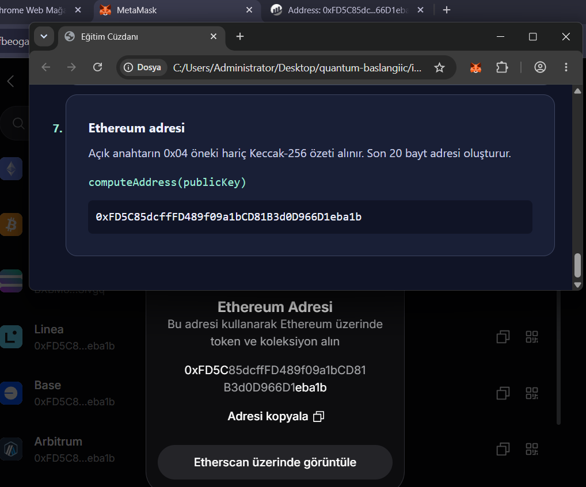

### İP-13 ilerleme durumu

1. **Tamamlandı.** İP-12’de ürettiğim eğitim cüzdanının 12 kelimesini ayrı bir tarayıcı profilinde MetaMask’e aktardım. Kişisel cüzdanıma dokunmadım.
2. **Tamamlandı.** MetaMask’teki ilk Ethereum hesabının adresi uygulamadaki adresle birebir eşleşti. Eşleşmenin ekran görüntüsünü bu bölüme ekledim. Görüntüde kurtarma kelimeleri, seed, entropi ve özel anahtar görünmüyor.
3. **Tamamlandı.** BIP39 test vektöründe son kelimeyi değiştirerek hem ret hem kabul sonucu gözlemledim.
4. **Tamamlandı.** Sonraki görevler için ayrı tarayıcı profilinde MetaMask’e aktardığım ve adresini doğruladığım ilk Ethereum hesabını seçtim. Değiştirilmiş kelime dizilerini yalnızca checksum deneyinde kullandım.

### Checksum deneyi

Deneyi İP-12’de kullandığım herkese açık BIP39 referans vektörüyle yaptım. İlk 11 kelimeyi sabit tuttum ve her örneği ethers.js içindeki `Mnemonic.isValidMnemonic` ile İngilizce kelime listesine göre doğruladım.

Her denemede ilk 11 kelime aynı kaldı. Yerine koyduğum iki kelime de BIP39 İngilizce listesinde yer alıyor.

| Deneme | 12. kelime | Sonuç | Açıklama |
| --- | --- | --- | --- |
| Orijinal diziyi doğrulama | `about` | Kabul | Dizideki checksum, entropiden yeniden hesaplanan checksum ile eşleşti. |
| Son kelimeyi değiştirme | `abandon` | Ret | Yeni kelime listede vardı ancak dizideki checksum, yeniden hesaplanan checksum ile eşleşmedi. |
| Son kelimeyi değiştirme | `actual` | Kabul | Tek kelime değişti ve ortaya çıkan dizinin checksum’ı yeni entropiyle eşleşti. |

Son kelime için orijinal dışındaki 2.047 seçeneği denediğimde 1.920’si reddedildi, 127’si kabul edildi. BIP39’da 12 kelime, 128 bit entropi ve 4 bit checksum taşır. Son kelimenin 11 bitinin 7’si entropiye, 4’ü checksum’a aittir. İlk 11 kelime sabitken kalan 7 entropi biti için 128 olasılık vardır ve her birine bir geçerli checksum karşılık gelir. Bu nedenle orijinalin yanında 127 farklı son kelime de doğrulamadan geçebilir. [BIP39 standardı](https://github.com/bitcoin/bips/blob/master/bip-0039.mediawiki#generating-the-mnemonic)

**Benim yorumum.** Geçerli bir mnemonic, BIP39 kelime listesi ve checksum kurallarını karşılar. Güvenli üretim ise kelimelerin dayandığı entropinin yeterli ve tahmin edilemez olmasını gerektirir. Checksum kontrolü entropinin nasıl üretildiğini göstermez.

## İP-14 · Test ETH Kaynağını Kendin Bul

- İP-13’te doğruladığım eğitim hesabını MetaMask’te açtım. Sepolia, test ağları menüsünde göründü.
- Ethereum’un ağ belgelerinde listelenen Google Cloud Web3 faucet’ini kullandım. Google hesabımla giriş yaptım ve alıcı olarak eğitim hesabımın açık Ethereum adresini girdim. [Ethereum ağ belgeleri](https://ethereum.org/developers/docs/networks/#sepolia) · [Google Cloud Sepolia Faucet](https://cloud.google.com/application/web3/faucet/ethereum/sepolia)
- Daha sonraki bir istekte faucet, Ethereum Sepolia için **Google hesabı ve cüzdan adresi başına günde bir dağıtım** sınırı olduğunu bildirdi. Bu koşulu faucet’in kendi uyarısından gördüm.
- Faucet, Ethereum Sepolia ağında `0xFD5C85dcffFD489f09a1bCD81B3d0D966D1eba1b` adresine **0,05 Sepolia ETH** gönderimi için **Transaction complete** mesajı gösterdi. Sepolia Etherscan’de işlemin durumunu **Success** olarak gördüm ve alıcı adresiyle gönderilen tutarı doğruladım. [Sepolia Etherscan işlem kaydı](https://sepolia.etherscan.io/tx/0xc1dd171ee4737b5973c24124ec94a98f76de7313d725c341660daf787ffcd65b)
- MetaMask ana ekranında aynı eğitim hesabının bakiyesinde **0,05 Sepolia ETH** gördüm. İşlem Geçmişi’nde Sepolia filtresini seçmeme rağmen gelen transfer listelenmedi ve ekranda cüzdana fon ekleme mesajı görünmeye devam etti. Alınan tutarı MetaMask bakiyesinden, transferin ayrıntılarını ise yukarıdaki Sepolia Etherscan işlem kaydından doğruladım.
- Google Cloud faucet’i kullandığım için tarayıcıda PoW bulmacası çözme adımı uygulanmadı.

### Ekran görüntüleri

MetaMask’teki **0,05 Sepolia ETH** bakiyesini, **Sepolia** filtresi seçiliyken boş görünen İşlem Geçmişi’ni ve Sepolia Etherscan’de eğitim hesabımın adres sayfasındaki **0,05 ETH** bakiyesini gösteren ekran görüntülerini aşağıya ekledim.

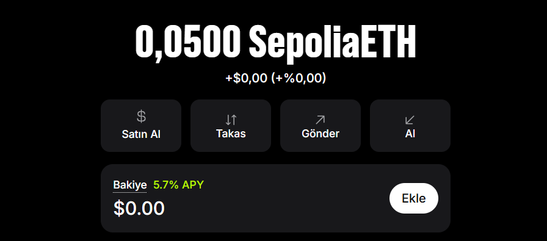

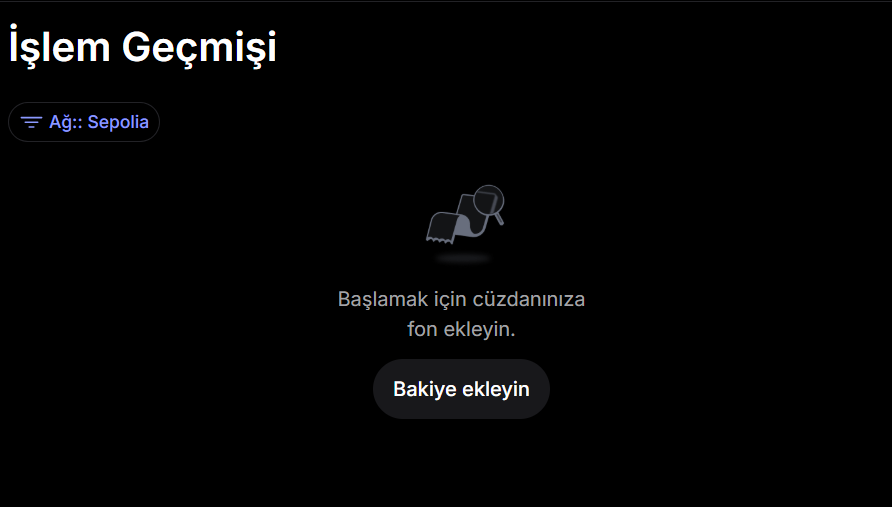

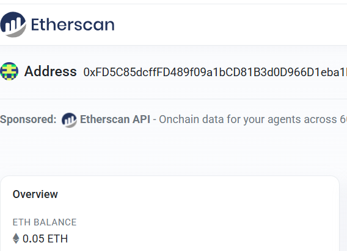

**Benim yorumum.** Açık adresim başkalarının bana test ETH göndermesini sağlar. Hesabımdan ETH harcamak için özel anahtarımla geçerli bir işlem imzası oluşturulması gerekir.

## İP-15 · Test USDC Edin ve İki Transferi Karşılaştır

### Test USDC edinme

Circle’ın resmî faucet’inde **USDC** ve **Ethereum Sepolia** seçeneklerini seçip ilk eğitim hesabıma 20 test USDC istedim. Ethereum Sepolia USDC sözleşme adresini Circle’ın belgelerinden doğruladım: `0x1c7D4B196Cb0C7B01d743Fbc6116a902379C7238`. [Circle faucet](https://faucet.circle.com/) · [Circle sözleşme adresi](https://docs-w3s-node-sdk.circle.com/variables/index.ETH_SEPOLIA.html)

MetaMask’in **Tokenlar** bölümünde Sepolia filtresi açıkken **20 USDC** ve **0,0500 SepoliaETH** gördüm. Bu bakiyeleri gösteren ekran görüntüsünü aşağıya ekledim.

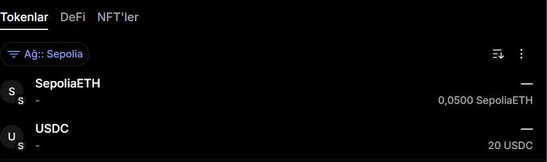

### Adım 2 · İkinci eğitim hesabına ETH ve USDC gönderme

MetaMask’te ikinci eğitim hesabını oluşturdum. Ethereum Sepolia ağında ilk eğitim hesabımdan (Account 1) ikinci hesaba (Account 2) **0,001 Sepolia ETH** ve **1 test USDC** gönderdim. İkinci hesabın Tokenlar bölümünde iki bakiyeyi de doğruladım.

İki transfer tamamlandıktan sonra ilk eğitim hesabımda **0,0485 Sepolia ETH** kaldığını gördüm. Bu bakiyeyi sonraki işlemlerin ağ ücretleri için ayırdım.

İki gönderim ekranını ve ikinci hesabın transferler sonrasındaki bakiyesini aşağıya ekledim. MetaMask gönderim ekranında ETH transferi için **0,0003 Sepolia ETH**, USDC transferi için **0,0002 Sepolia ETH** ağ ücreti gösterdi. Bunlar ekrandaki tahminler. Kesin ücretleri zincirdeki işlem kayıtlarından kontrol edeceğim.

**ETH gönderimi**

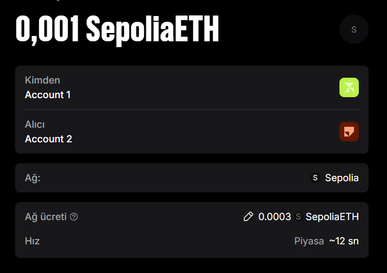

**USDC gönderimi**

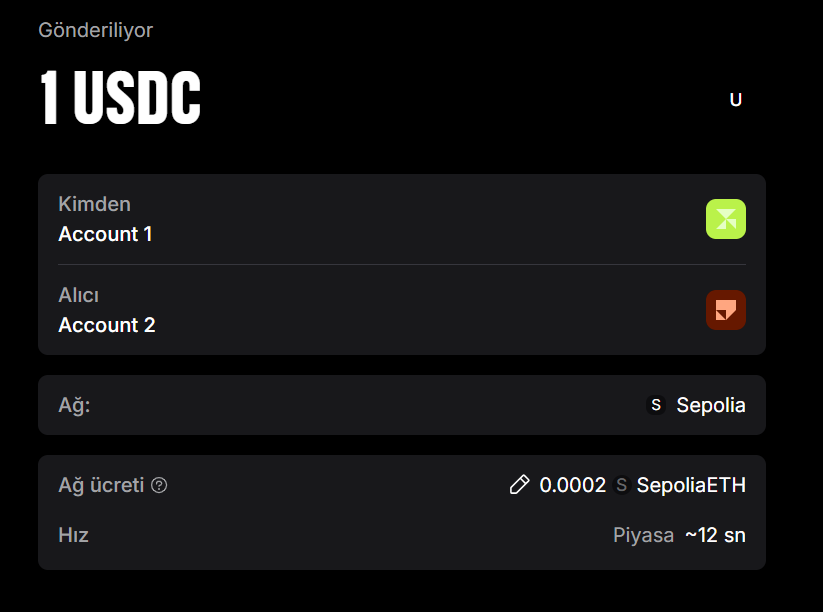

**İkinci hesabın bakiyesi**

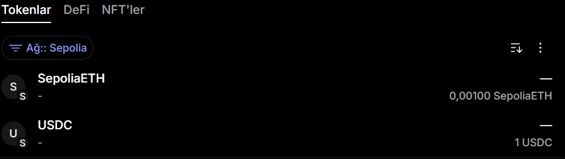

### Adım 3 · ETH ve USDC işlemlerini karşılaştırma

- [0,001 Sepolia ETH gönderiminin işlem kaydı](https://sepolia.etherscan.io/tx/0xd4925cc24d9b21c2993d8769f3473e56834d9ba8728b8f95fba8f364c6d81880)
- [1 test USDC gönderiminin işlem kaydı](https://sepolia.etherscan.io/tx/0x74e0132bcf88e35940540acfaf549c04a0ca6d5f9496da00827884fb5173e9c8)

Aşağıda iki işlemin Sepolia Etherscan kayıtlarını karşılaştırdım.

#### 0,001 Sepolia ETH gönderimi

- **Status ve blok.** Etherscan’de işlemin `12219101` numaralı blokta `Success` olarak kaydedildiğini gördüm.
- **From (gönderen).** İlk eğitim hesabım `0xFD5C85dcffFD489f09a1bCD81B3d0D966D1eba1b`.
- **To (işlemin hedefi).** Etherscan’de ikinci eğitim hesabımın adresini gördüm: `0x5C91602B4A9674Aac80b2e13577814deeB4cE2Ae`. Sepolia’nın yerel varlığı olan ETH doğrudan bu adrese gönderildi.
- **Value (işlemle taşınan ETH).** Etherscan’de ikinci eğitim hesabına gönderdiğim **0,001 ETH** görünüyor.
- **Input Data (işleme eklenen veri).** Etherscan’de `0x` gördüm. Bu, doğrudan ETH gönderimine ek veri konulmadığını gösteriyor.
- **Transaction Fee (ağ ücreti).** MetaMask onay ekranında **0,0003 Sepolia ETH** tahmini gösterdi. Etherscan’de ödediğim kesin ağ ücreti **0,000306900003069 Sepolia ETH** olarak görünüyor.
- **Token transferi ve log.** Doğrudan ETH gönderimi bir ERC-20 sözleşmesini çalıştırmadığı için ERC-20 `Transfer` kaydı beklenmez. Gönderilen miktarı **Value** alanında ararım.

#### 1 test USDC gönderimi

- **Interacted With (To).** Etherscan’de işlemin hedefi olarak Sepolia USDC sözleşmesini gördüm (`0x1c7D4B196Cb0C7B01d743Fbc6116a902379C7238`).
- **Value (işlemle taşınan ETH).** Etherscan’de **0 ETH** gördüm. Gönderdiğim **1 USDC**, ERC-20 transfer özetinde yer alıyor.
- **Input Data (işleme eklenen veri).** Etherscan, `transfer(address to, uint256 value)` fonksiyonunu ve `0xa9059cbb` yöntem kimliğini gösterdi. İlk parametrede ikinci eğitim hesabımın adresi (`0x5C91602B4A9674Aac80b2e13577814deeB4cE2Ae`) yer alıyor. İkinci parametredeki onaltılık `0xf4240`, ondalık olarak **1.000.000** temel birime karşılık geliyor. USDC 6 ondalık basamak kullandığı için bu tutar **1 USDC** ediyor.
- **Transaction Fee (ağ ücreti).** MetaMask onay ekranında **0,0002 Sepolia ETH** tahmini gösterdi. Etherscan’de kesin ücret **0,000227668502276685 Sepolia ETH** olarak görünüyor. Ücret ilk hesabın ETH bakiyesinden karşılandı.
- **ERC-20 Tokens Transferred.** Etherscan’in transfer özetinde ilk eğitim hesabından (`…eba1b`) ikinci eğitim hesabına (`…E2Ae`) **1 USDC** gönderildiğini gördüm.
- **Logs (olay kayıtları).** Etherscan’in **Logs (1)** sekmesinde USDC sözleşmesinin ürettiği tek `Transfer` olayını gördüm. `from` ilk eğitim hesabını (`…eba1b`), `to` ikinci eğitim hesabını (`…E2Ae`) gösteriyor. `value` alanındaki **1.000.000** temel birim **1 USDC** ediyor. Bu değerler transfer özetiyle ve **Input Data** ile eşleşiyor.

#### Token’ı görüntülemek ve almak

MetaMask’e USDC sözleşme adresini eklemek, cüzdanın o sözleşmedeki mevcut bakiyemi okumasını ve Tokenlar listesinde göstermesini sağlar. USDC almak ise zincirde gerçekleşir. Başarılı transfer, USDC sözleşmesinde alıcı adresinin bakiyesini artırır. Token henüz MetaMask’te listelenmemiş olsa bile alıcı bakiyesi zincirden kontrol edilebilir.

**Benim yorumum.** MetaMask gönderim ekranında miktarı **1 USDC**, tahmini ağ ücretini ise **0,0002 Sepolia ETH** olarak gördüm. Etherscan’de **Transaction Fee** alanında kesin ücret **0,000227668502276685 Sepolia ETH**, **Transfer** kaydında ise gönderilen tutar **1 USDC** olarak yer aldı. Böylece gönderilen token tutarının USDC bakiyesinden, ağ ücretinin ise ilk hesabın Sepolia ETH bakiyesinden karşılandığını gördüm.

## C · Takım Sözleşmesiyle İşlem Yap

### İP-16 · Remix ile Gerçek İsmini Kaydet

1. **Derleme.** Etherscan’deki `src/QuantumKayit.sol` dosyasının Solidity kodunu Remix’te yeni bir `QuantumKayit.sol` dosyasına kopyalayıp derledim.
2. **Sözleşmeye bağlanma.** Remix’te **Browser Extension → MetaMask** ile Sepolia’ya bağlandım. İP-13’te doğruladığım ilk eğitim hesabını (`…eba1b`) seçtim ve **Add Contract** ile takımın mevcut sözleşmesini açtım. Takım sözleşmesinin adresi `0x81Dd700C459BF2806A1B5F2a349c89f0106A9036`.
3. **İsim biçimi.** Tam ad-soyadımı hazırlarken Türkçe harfleri dönüştürdüm, tüm harfleri küçülttüm ve boşlukları kaldırdım. Sonuç yalnızca `a–z` harflerini içeriyordu.
4. **İlk kayıt.** İlk `register` çağrısında yalnızca adımı girdim. Etherscan’de işlemin durumunu **Success** olarak gördüm. Soyadım bu kayıtta eksik kaldı. [Sepolia Etherscan işlem kaydı](https://sepolia.etherscan.io/tx/0x4bfd008a11f78acb1ec6807ff40fc3fb91a3af121ef6e15b24358278c8c8f696)
5. **Aynı hesapla ikinci deneme.** Remix, `estimateGas` simülasyonu sırasında **Bu cuzdan zaten kayitli** hatasını gösterdi. Hata zincire gönderimden önce oluştu. Gas tahmini bir simülasyon olduğu için işlem hash’i üretmedi.
6. **Site kontrolü ve kullanılan hesap.** İlk kaydı kontrol sitesinde bulamadım. İkinci eğitim hesabında ağ ücreti için yetersiz bakiye uyarısı aldım. Görev İP-13’te doğrulanan ilk hesabı istiyordu. Tam ad-soyad kaydını üçüncü eğitim hesabından gönderdim ve takımın kontrol sitesinde göründüğünü doğruladım. İşlem kanıtlarını İP-17’de kaydettim. [Takımın kontrol sitesi](https://haloclineblockchain.vercel.app/) · [Tam ad-soyad kayıt işlemi](https://sepolia.etherscan.io/tx/0xa189feb2d95365ff17ee9f380f674444e1010d0f839660755284fb595ef1c0b2)

**Benim yorumum.** Zincir kaydını Etherscan’deki işlem durumu ve sözleşmenin `Registered` olayı üzerinden kontrol ederim. Takımın sitesinde ise kaydın sitenin isim listesiyle eşleşip görüntülendiğini kontrol ederim.

## İP-17 · Explorer ile Kaydı Doğrula

İP-16’da üçüncü eğitim hesabımla yaptığım tam ad-soyad kaydını esas aldım. İşlem hash’i İP-7’deki akış şemasında yer alıyor. [Sepolia Etherscan işlem kaydı](https://sepolia.etherscan.io/tx/0xa189feb2d95365ff17ee9f380f674444e1010d0f839660755284fb595ef1c0b2)

### İşlem ayrıntıları

| Alan | Bu işlemde neyi gösteriyor? |
| --- | --- |
| **From** | İşlemi gönderen üçüncü eğitim hesabım `0xe1E5ae128721401ca0dDC917E9360b2a5543D242`. |
| **To** | İşlemin doğrudan hedefi `0xdb9B1e94B5b69Df7e401DDbedE43491141047dB3`. Kayıt durumunu okuduğum takım sözleşmesinin adresi `0x81Dd700C459BF2806A1B5F2a349c89f0106A9036`. |
| **Gas Used / Transaction Fee** | Yürütme sırasında **805.987 gas** harcandı. Bu, **925.949 gas** limitinin **%87,04**’ü. Etkin gas fiyatı **1,500000016 Gwei** ve **Transaction Fee** alanındaki toplam ücret **0,001208980512895792 Sepolia ETH**. |
| **Nonce** | Gönderen hesabımın bu işlemdeki sıra numarası **0**. |
| **Status** | **Success**, işlemin **12219715** numaralı blokta başarıyla yürütüldüğünü gösterir. |
| **Input Data** | İşlemin dış çağrısı `redeemDelegations` (yöntem kimliği `0xcef6d209`). `_executionCallDatas` parametresindeki iç çağrı takım sözleşmesini hedefliyor ve `hikmetyagci` ismini taşıyor. |

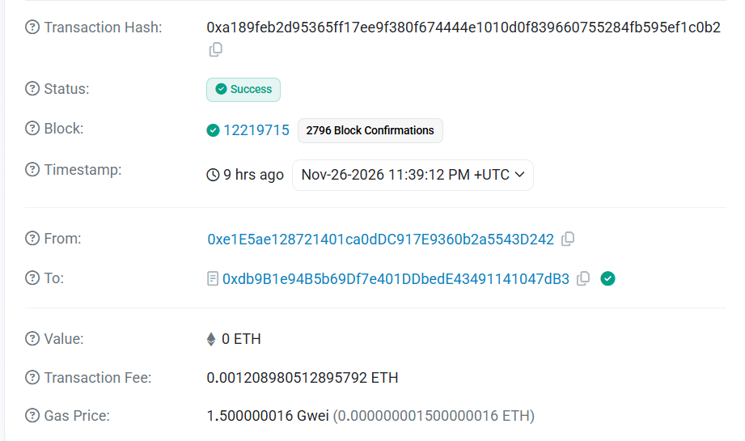

### İşlem kanıtları ve güncel kayıt

1. **Decode Input Data.** Bu görünümdeki `_executionCallDatas` alanı takım sözleşmesinin adresiyle başlıyor. İç çağrıda yöntem kimliği `0xf2c298be`, metnin uzunluğu `0x0b` (11 bayt). Ardından gelen `68696b6d65747961676369` baytları UTF-8 olarak `hikmetyagci` metnine karşılık geliyor. [İşlem ayrıntıları](https://sepolia.etherscan.io/tx/0xa189feb2d95365ff17ee9f380f674444e1010d0f839660755284fb595ef1c0b2)

   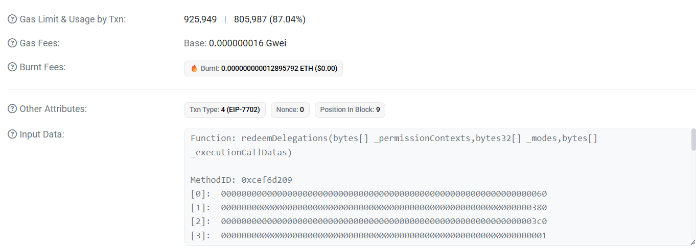

   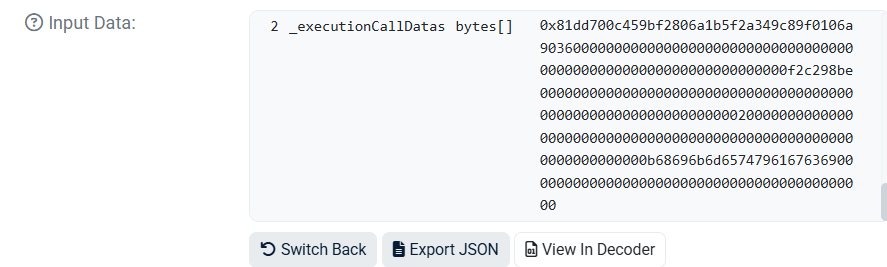

2. **Registered.** Takım sözleşmesi `0x81Dd700C459BF2806A1B5F2a349c89f0106A9036` bu işlemin makbuzunda `Registered` olayını yayımladı. Olayda `uye` üçüncü eğitim hesabım `0xe1E5ae128721401ca0dDC917E9360b2a5543D242`, `isim` değeri `hikmetyagci` ve `sira` değeri **23**. [İşlem logları](https://sepolia.etherscan.io/tx/0xa189feb2d95365ff17ee9f380f674444e1010d0f839660755284fb595ef1c0b2#eventlog)

   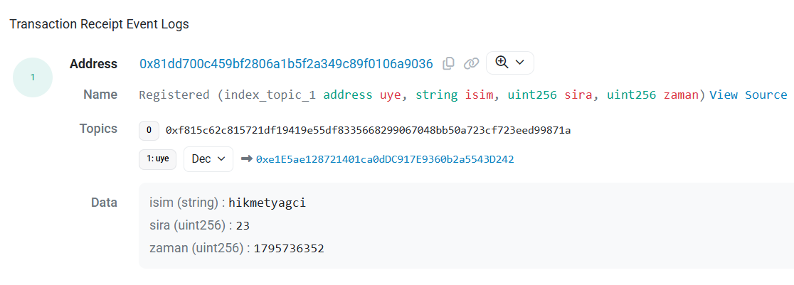

3. **Read Contract.** Üçüncü eğitim hesabımla sorguladığım `kayitliMi` **`true`** döndürdü. Bu fonksiyon kayıt durumunu bir `bool` olarak verir. `tumKayitlar` çıktısında aynı adres için `hikmetyagci` adını ve **23** sıra numarasını gördüm. İkisi de `Registered` olayıyla eşleşiyor. [Takım sözleşmesinin Read Contract sekmesi](https://sepolia.etherscan.io/address/0x81Dd700C459BF2806A1B5F2a349c89f0106A9036#readContract)

   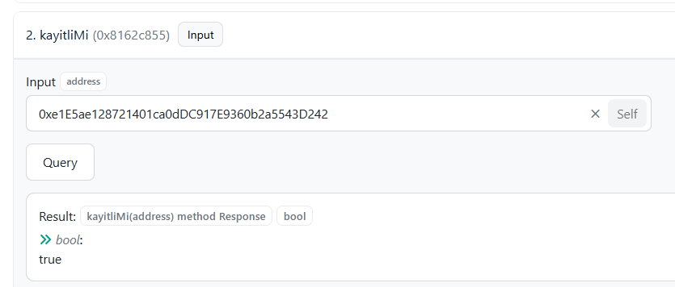

   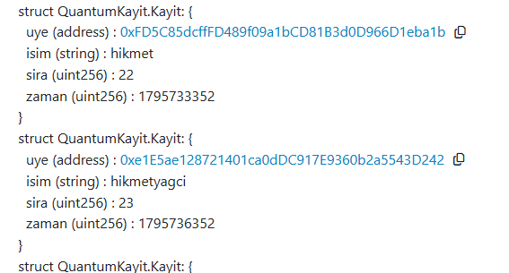

### İkinci kayıt denemesi

İlk eğitim hesabımla yaptığım ikinci denemede Remix’in `estimateGas` simülasyonu **Bu cuzdan zaten kayitli** hatası verdi. İşlem ağa gönderilmediği için bu denemenin işlem hash’i ve makbuzu yok. Bloğa alınmış başarısız bir çağrıda ise işlem makbuzu oluşur ve `status = 0` okunur.

**Benim yorumum.** Input Data hangi ismi gönderdiğimi, `Registered` olayı sözleşmenin o işlem sırasında hangi adres ve isim için kayıt olayı ürettiğini gösterir. Güncel state, sorgu anında adresimin kayıtlı olup olmadığını ve hangi isimle eşleştiğini yanıtlar. Hesap 3 için işlem girdisindeki, olay kaydındaki ve `tumKayitlar` çıktısındaki isim aynı: `hikmetyagci`.

## İP-18 · Takım Sözleşmesinin Kopyasını Deploy Et ve Verify Et

### 1. Kaynak kodu ve lisansı depoya ekledim

Takımın Sepolia’daki sözleşmesi `0x81Dd700C459BF2806A1B5F2a349c89f0106A9036`. Sözleşmenin paylaşılan kaynak kodunu [src/QuantumKayit.sol](../src/QuantumKayit.sol) dosyasına ekledim ve `SPDX-License-Identifier: MIT` satırını korudum. Bu kopyayı ortak sözleşme deneyi için kullandım. [Takım sözleşmesinin doğrulanmış kaynak kodu](https://sepolia.etherscan.io/address/0x81Dd700C459BF2806A1B5F2a349c89f0106A9036#code)

### 2. Derleme ayarlarını kontrol ettim

Takım sözleşmesinin Etherscan **Contract → Code** sekmesinde **Source Code Verified (Exact Match)** sonucunu ve derleme ayarlarını gördüm. Remix’te kendi kopyamı aynı ayarlarla derledim.

- **Solidity derleyicisi** `0.8.24+commit.e11b9ed9`
- **Optimizasyon** kapalı. Etherscan’de **No with 200 runs** yazıyor. Buradaki **No**, optimizasyonun devre dışı olduğunu gösteriyor.
- **EVM hedefi** `cancun`

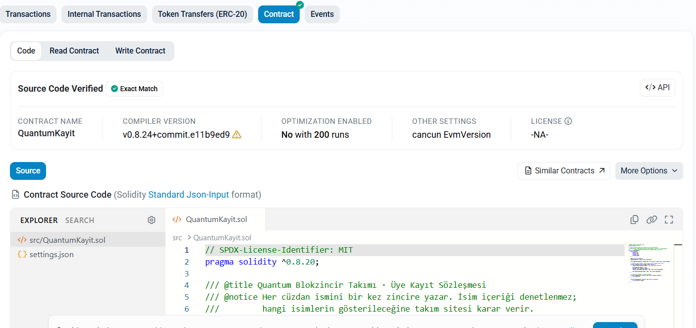

### 3. Kendi kopyamı Sepolia’ya deploy ettim

Remix’in **Deploy & Run Transactions** bölümünde MetaMask ile Sepolia’ya bağlandım. Hesap 3’ü kullanarak derlenmiş `QuantumKayit` sözleşmesini **Deploy** düğmesiyle yayımladım. Sözleşme constructor parametresi istemediğinden Remix makbuzunda çözümlenen girdi `{}` olarak göründü.

Remix makbuzunda `status = 1` ve blok numarası **12222590** yazıyordu. **contract address** alanından yeni kopyanın adresini, **transaction hash** alanından ise bu kopyayı oluşturan işlemin kimliğini aldım.

- **Yeni sözleşme adresi** [`0xac942aE23072fA8A4a09d75148380F6c42f7Db7F`](https://sepolia.etherscan.io/address/0xac942aE23072fA8A4a09d75148380F6c42f7Db7F)
- **Deploy işlem hash’i** [`0x0caf7a1e80eab6322b8cb4fac3f414903c009a8b98ad3474158bca877af95c27`](https://sepolia.etherscan.io/tx/0x0caf7a1e80eab6322b8cb4fac3f414903c009a8b98ad3474158bca877af95c27)

### 4. Yeni kopyanın kaynak kodunu Etherscan’de doğruladım

Remix’te **Contract Verification** eklentisiyle doğrulamayı denedim. İlk kontrolde **Receipts** sekmesinde `No contracts submitted for verification` yazıyordu. O sırada Etherscan sözleşme sekmesinde bytecode ve **Verify and Publish** bağlantısı görünüyordu.

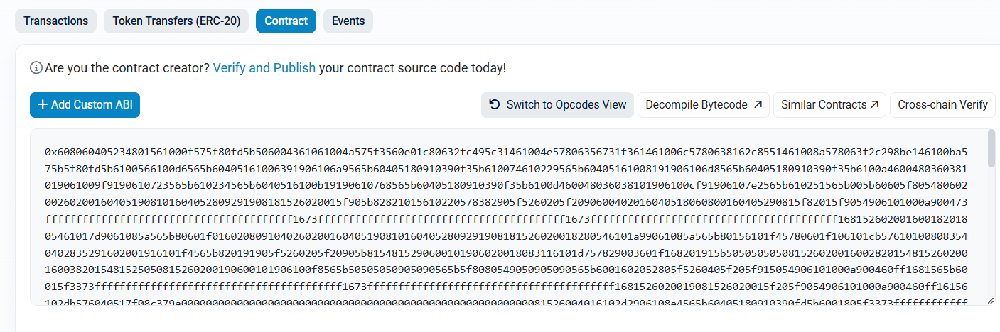

Sonraki denemede Remix, `[Sourcify] Polling timed out` uyarısı gösterdi. Bu uyarı Sourcify sonucunun bekleme süresinde alınamadığını bildiriyordu. Etherscan sonucunu kendi sözleşme adresimin **Contract → Code** sekmesinden kontrol ettim. Bu sekmede **Source Code Verified (Exact Match)** sonucu, `QuantumKayit.sol` kaynak dosyası ve `settings.json` görünüyordu. Üst bölümde derleyici sürümünün `v0.8.24+commit.e11b9ed9`, optimizasyonun kapalı ve EVM hedefinin `cancun` olduğunu teyit ettim. Exact Match, kaynak kodun ve derleme ayarlarının zincirdeki bytecode ile eşleştiğini gösterir. Güvenlik denetimi ayrı bir işlemdir. [Yeni kopyanın Etherscan Code sekmesi](https://sepolia.etherscan.io/address/0xac942aE23072fA8A4a09d75148380F6c42f7Db7F#code)

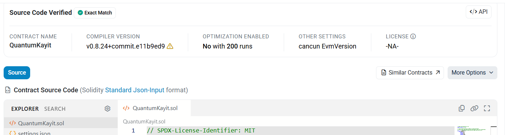

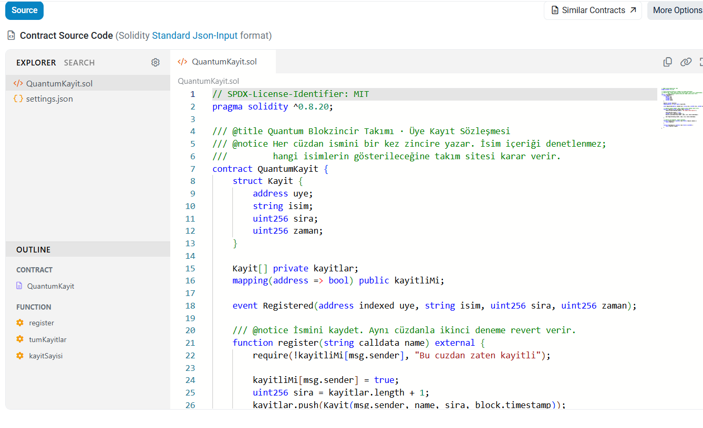

### 5. Yeni kopyanın boş başladığını kontrol ettim

Takım sözleşmesinde `hikmetyagci` adıyla kayıtlı Hesap 3’ün adresini (`0xe1E5ae128721401ca0dDC917E9360b2a5543D242`) yeni kopyadaki `kayitliMi` sorgusuna girdim. Remix `bool: false` döndürdü. Bu sonuç yalnızca o adresin yeni kopyada kayıtlı olmadığını gösteriyor.

Ardından yeni sözleşmenin `tumKayitlar` fonksiyonunu parametresiz çağırdım. Remix’te **decoded output** alanında dizi türü göründü ve dizide hiç kayıt yoktu. Böylece yeni kopyanın kayıt listesinin tamamen boş olduğunu doğruladım. İlk `register` çağrısını sonraki göreve bıraktım.

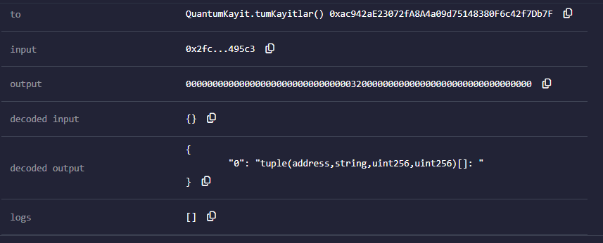

### 6. Mevcut sözleşmeyi Remix’te yeniden açtım

Sözleşme kartını Remix listesinden kaldırdım. Sonra **Deployed Contracts → Add Contract** bölümünden aynı Sepolia adresini tekrar ekledim. Kart yeniden göründüğünde `QuantumKayit` sözleşmesinin fonksiyonlarına o adres üzerinden erişebildim.

**Deploy**, zincire sözleşme oluşturma işlemi gönderir. Başarılı olduğunda yeni bir sözleşme adresi ve o adrese ait depolama alanı oluşur. **At Address / Add Contract**, derlenmiş sözleşmenin arayüzünü zincirde zaten var olan bir adrese bağlar. Bu adım Remix’teki listeyi günceller ve zincire işlem göndermez.

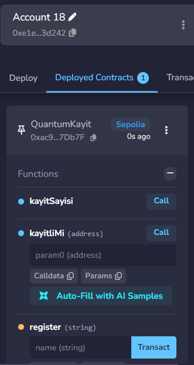

**Benim yorumum.** Kod, kayıtların nasıl saklanacağını belirler. Kayıtlar ise işlemlerin çalıştığı sözleşme adresine ait depolama alanında tutulur. Yeni deploy kendi boş dizisi ve varsayılan olarak `false` dönen adres eşlemesiyle başladı. Bu yüzden Hesap 3 takım sözleşmesinde kayıtlıyken yeni kopyada `kayitliMi` sonucu `false`, kayıt listesi de boştu. Eski kayıtların taşınması için yeni sözleşmeye ayrıca veri yazılması gerekir.

## İP-19 · Etherscan Write Contract ile Kendi Sözleşmeme Kaydol

### 1. Sözleşme adresini ve hesabı kontrol et

Sepolia’da İP-18’de yayımladığım kopyanın adresi `0xac942aE23072fA8A4a09d75148380F6c42f7Db7F`. Takım sözleşmesinin adresi `0x81Dd700C459BF2806A1B5F2a349c89f0106A9036`. İşlemin hedefi kendi kopyam. [Kendi sözleşmemin Write Contract sekmesi](https://sepolia.etherscan.io/address/0xac942aE23072fA8A4a09d75148380F6c42f7Db7F#writeContract)

Etherscan’in **Write Contract** bölümünde **Connect to Web3** ile MetaMask’i Sepolia’ya bağladım. Görev İP-13’te doğrulanan ilk eğitim hesabını (`…eba1b`) istiyordu. Kendi kopyamdaki ilk kaydı üçüncü eğitim hesabıyla (`…3D242`) yaptım. İP-18’de kopyanın `tumKayitlar` sorgusu boş dönmüştü. [Etherscan Read / Write Contract kılavuzu](https://info.etherscan.com/how-to-use-read-or-write-contract-features-on-etherscan/)

### 2. İlk kaydı gönder ve işlem sonucunu kontrol et

`register` fonksiyonunun **name** alanına `hikmetyagci` yazıp **Write** üzerinden işlemi gönderdim. Etherscan işlem özetinde **Status: Success**, blok **12222902** ve gönderen olarak Hesap 3 (`0xe1E5ae128721401ca0dDC917E9360b2a5543D242`) görünüyor. Dış işlemin **To** alanı `0xdb9B1e94B5b69Df7e401DDbedE43491141047dB3`. Makbuzdaki `Registered` olayını kendi kopyam `0xac942aE23072fA8A4a09d75148380F6c42f7Db7F` yayımladı. [Sepolia Etherscan işlem kaydı](https://sepolia.etherscan.io/tx/0x8610e51762eddcdb851b30dee430919e6c236ccb32f9b929843a28706e75c600)

### 3. Kaydı ve olay sonucunu karşılaştırdım

Kendi kopyamın `kayitliMi` sorgusu Hesap 3 (`0xe1E5ae128721401ca0dDC917E9360b2a5543D242`) için `true` döndürdü. `kayitSayisi` sonucu **1** ve `tumKayitlar` çıktısındaki tek kayıt aynı adres için `hikmetyagci`, sıra **1**. Takım sözleşmesinde aynı cüzdan aynı isimle **23. sırada** kayıtlı. Böylece aynı adresin iki sözleşmede ayrı kayıtları olduğunu sorgu sonuçlarından gördüm.

İşlemin **Logs** sekmesindeki `Registered` olayında `uye` Hesap 3, `isim` değeri `hikmetyagci`, `sira` değeri **1** ve `zaman` değeri `1795776996`. Bu alanlar `tumKayitlar` çıktısıyla eşleşiyor. [Registered olay kaydı](https://sepolia.etherscan.io/tx/0x8610e51762eddcdb851b30dee430919e6c236ccb32f9b929843a28706e75c600#eventlog)

Takımın kontrol sitesi yalnızca takım sözleşmesindeki kayıtları okur. [Kendi sözleşmemin Read Contract sekmesi](https://sepolia.etherscan.io/address/0xac942aE23072fA8A4a09d75148380F6c42f7Db7F#readContract)

**Benim yorumum.** `register`, çağrıyı gönderen adresi sözleşmenin kendi `kayitliMi` eşlemesinde kontrol eder. Takım sözleşmesinde Hesap 3 için değer zaten `true`, bu yüzden o sözleşmeye aynı cüzdanla ikinci kayıt denemesi reddedilir. Kendi kopyamda bu adresin değeri ilk işlemden önce `false` idi. Etherscan’den gönderdiğim başarılı kayıt, yalnızca kendi kopyamın durumunu güncelledi.

## D · Kendi Etkinlik Sözleşmeni Geliştir

### İP-20 · İlk Etkinlik Kaydını Oluştur

[EtkinlikKaydi.sol](../src/EtkinlikKaydi.sol) tek bir etkinliği temsil ediyor. Etkinliğin adı **Quantum Atölyesi**. Takma adlar, cüzdan adresini metne eşleyen `takmaAdlar` mapping’inde sözleşme durumuna yazılıyor. `kaydol` fonksiyonu adres parametresi almıyor. Yazılacak kaydın anahtarı olarak `msg.sender`, yani çağrıyı yapan adres kullanılıyor. `public` tanımı sayesinde Solidity, herhangi bir adresin kaydını okumak için `takmaAdlar(adres)` fonksiyonunu otomatik oluşturuyor.

#### Remix VM deneyi

İlk yerel hesabın (`…eddC4`) `kaydol(string)` işlemi Remix VM’de 2. blokta başarıyla tamamlandı. Kaydın içeriğini `takmaAdlar` ile ayrıca okuyacağım.

Sözleşmeyi Remix’te derledim ve Remix VM’de dağıttım. Terminalde `EtkinlikKaydi.(constructor)` işlemi için **Transaction mined and execution completed** durumunu gördüm. Yerel sözleşme adresi `0xd9145CCE52D386f254917e481eB44e9943F39138`.

1. `EtkinlikKaydi.sol` dosyasını Remix’te aç ve Solidity Compiler ile derle.
2. **Deploy & Run Transactions** panelinde **Remix VM** ortamını ve **EtkinlikKaydi** sözleşmesini seç. **Deploy** ile yerel bir örnek oluştur.
3. İlk yerel hesabın adresini kopyala ve `kaydol` ile `mavi` takma adını yaz. Aynı sözleşme örneğinde ikinci yerel hesaba geç, adresini kopyala ve `kaydol` ile `yesil` takma adını yaz.
4. Aynı sözleşmede `takmaAdlar` ile iki adresi ayrı ayrı sorguladım. Remix’in **decoded output** alanında ilk yerel hesap (`…eddC4`) için `mavi`, ikinci yerel hesap (`…35cb2`) için `yesil` döndüğünü doğruladım. Böylece iki takma adın kendi adresleri altında saklandığını gördüm.

**Benim yorumum.** İlk sürüm boş veya çok uzun takma adlara izin veriyor. Farklı adresler aynı takma adı kullanabiliyor. Bir adres yeniden kaydolursa önceki takma adın üzerine yazılıyor. Boş metin kaydı ile hiç kayıt yapılmamış bir adres okumada aynı sonucu veriyor.

### İP-21 · Kapasite ve Kayıt Kurallarını Ekle

[EtkinlikKaydiV2.sol](../src/EtkinlikKaydiV2.sol) boş takma adı ve bir adresin ikinci kaydını reddeder. Kapasite üçtür. Toplamı `kayitSayisi()` ile okuyabilirim. Sözleşme, takma adı yazmadan ve sayacı artırmadan önce tüm kuralları kontrol eder. İP-20 sürümü [EtkinlikKaydi.sol](../src/EtkinlikKaydi.sol) dosyasında duruyor.

#### Remix VM deneyi

`EtkinlikKaydiV2.sol` dosyasını Remix’te derleyip **Remix VM** ortamında dağıttım. Kabul ve ret sonuçlarını aşağıda kaydettim.

| Deneme | Beklenen sonuç | Remix VM gözlemi |
| --- | --- | --- |
| İlk yerel hesapla `mavi` | Kabul, toplam 1 | Kabul. `kayitSayisi()` 1 döndürdü. |
| İlk hesapla tekrar `turkuaz` | Ret, toplam 1 | Remix VM işlemi `Bu adres zaten kayitli` hatasıyla geri aldı. Ardından `kayitSayisi()` yine 1 döndürdü. |
| İkinci yerel hesapla boş metin | Ret, toplam 1 | İşlem `Takma ad bos olamaz` hatasıyla geri alındı. İşlem geri alındığı için sayaç 1 kaldı. |
| İkinci ve üçüncü geçerli kayıt | Kabul, toplam 3 | Son sayaç okuması 3 döndürdü. |
| Farklı bir hesapla `sari` | Ret, toplam 3 | `…cabaB` hesabının işlemi `Etkinlik kapasitesi dolu` hatasıyla geri alındı. Ardından `kayitSayisi()` 3 döndürdü. |

**Benim yorumum.** Bir kişi birden fazla cüzdan adresi oluşturabilir ve her adresle ayrı kayıt yapabilir. Sözleşme çağrıyı yapan adresi bildiği için kapasite üç farklı adresle sınırlıdır. Gerçek kişi sayısını doğrulamak için ayrıca kimlik doğrulaması gerekir.

### İP-22 · Görevli ve Giriş Kontrolünü Ekle

[EtkinlikKaydiV3.sol](../src/EtkinlikKaydiV3.sol) dağıtım sırasında `msg.sender` adresini `gorevli` olarak belirler. `girisVer(katilimci)` çağrısında sözleşme önce çağrıyı yapanın görevli olup olmadığını, sonra katılımcının kayıt ve giriş durumunu kontrol eder. `girisYaptiMi(adres)` dışarıdan okunabilir. Başarılı kayıtta `KayitYapildi`, başarılı girişte `GirisYapildi` olayı yayımlanır. İki olayda da katılımcı adresi yer alır.

#### Remix VM deneyi

V3 sözleşmesini Remix VM’de ilk yerel hesapla dağıttım. `gorevli()` çıktısı dağıtımı yapan `0x5B38Da6a701c568545dCfcB03FcB875f56beddC4` adresiyle eşleşti. İP-21 kayıt denemelerini aynı sözleşmede tekrarladım. Kapasite dolduğunda kayıt olamayan dördüncü hesabı giriş kontrolünde kullandım.

| Deneme | Beklenen sonuç | Remix VM gözlemi |
| --- | --- | --- |
| İlk geçerli kayıt | Kabul, sayaç 1 ve `KayitYapildi` olayı | `kayitSayisi()` 1 döndürdü. İşlem günlüğündeki `KayitYapildi` olayı ilk yerel hesabın adresini (`…eddC4`) ve `mavi` takma adını gösterdi. |
| Aynı adresle `turkuaz` kullanarak tekrar kayıt | Ret, sayaç 1 | Remix VM işlemi `Bu adres zaten kayitli` hatasıyla geri aldı. Ardından `kayitSayisi()` yine 1 döndürdü. |
| Yeni adresle boş takma ad | Ret, sayaç 1 | Remix VM işlemi `Takma ad bos olamaz` hatasıyla geri aldı. Ardından `kayitSayisi()` yine 1 döndürdü. |
| İkinci ve üçüncü geçerli kayıt | Kabul, toplam 3 | İki kayıttan sonra `kayitSayisi()` 3 döndürdü. |
| Dördüncü adresle `turuncu` kaydı | Ret, sayaç 3 | Remix VM işlemi `Etkinlik kapasitesi dolu` hatasıyla geri aldı. Reddedilen işlem sayacı değiştirmedi. |
| Görevli kayıtlı ilk katılımcıya giriş verir | Kabul, durum `true` ve `GirisYapildi` olayı | İlk katılımcı (`…eddC4`) için `girisYaptiMi` sorgusu `true` döndürdü. İşlem günlüğündeki `GirisYapildi` olayı aynı katılımcı adresini gösterdi. |
| Görevli olmayan ikinci hesap kendi adresine giriş vermeyi dener | Ret, hedefin durumu `false` kalır | Remix VM, `…35cb2` hesabının çağrısını `Yalnizca gorevli giris verebilir` hatasıyla geri aldı. Sonraki `girisYaptiMi` sorgusu `false` döndürdü. |
| Görevli kayıtsız dördüncü adrese giriş verir | Ret, hedefin durumu `false` kalır | Remix VM işlemi `Katilimci kayitli degil` hatasıyla geri aldı. Dördüncü adres için `girisYaptiMi` sorgusu `false` döndürdü. |
| Görevli ilk katılımcıya yeniden giriş verir | Ret, ilk girişin durumu `true` kalır | Remix VM işlemi `Katilimci zaten giris yapti` hatasıyla geri aldı. Sonraki `girisYaptiMi` sorgusu `true` döndürdü. |

**Benim yorumum.** Arayüzde bir düğmeyi gizlemek yalnızca o ekranı etkiler. Bir kullanıcı aynı fonksiyonu Remix veya başka bir araçla doğrudan çağırabilir. Sözleşme her çağrıda `msg.sender` ile görevli adresini karşılaştırdığı için yetki kontrolü kullanılan arayüzden bağımsız çalışır.

#### Remix VM ekran görüntüleri

**Dağıtım ve ilk kayıt**

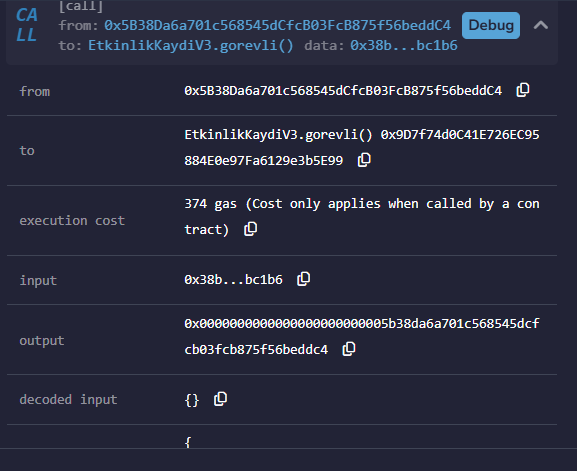

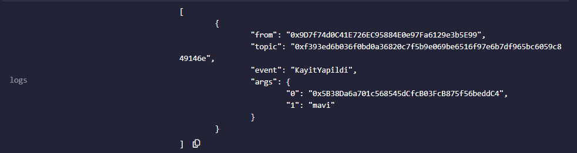

**Kayıt kuralları ve kapasite**

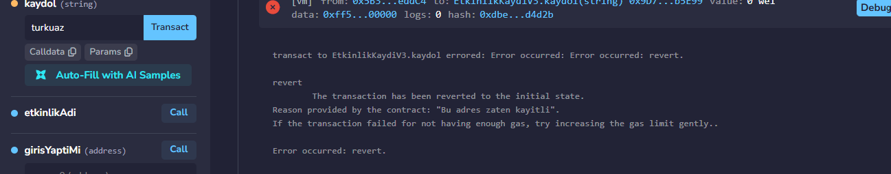

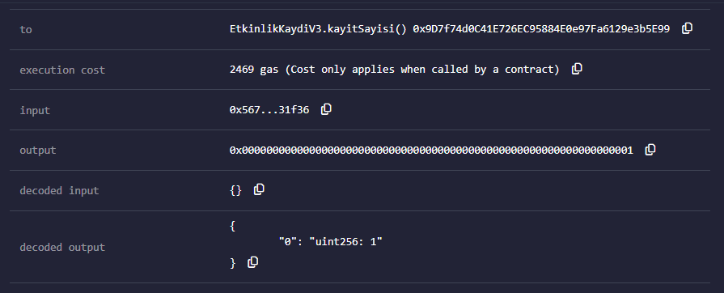

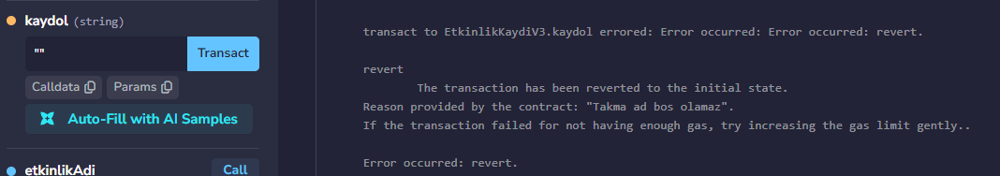

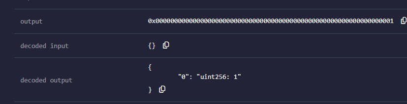

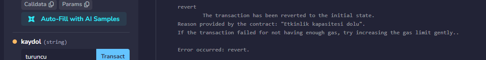

**Giriş ve yetki kontrolü**

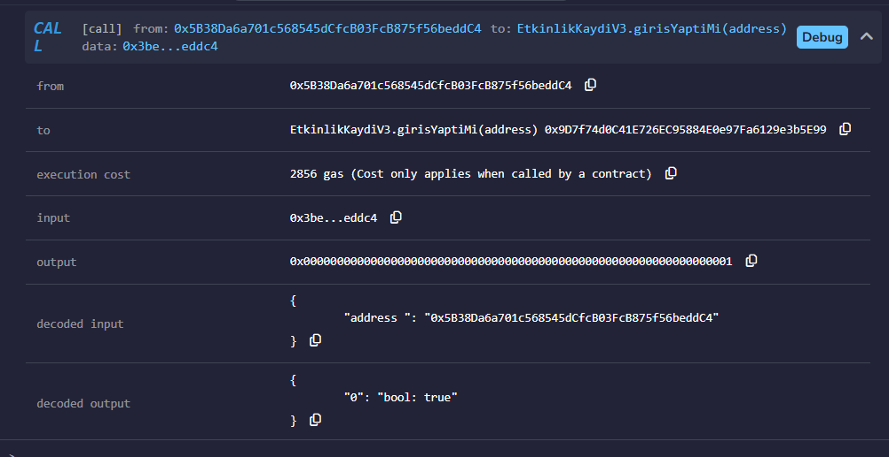

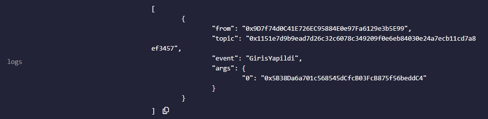

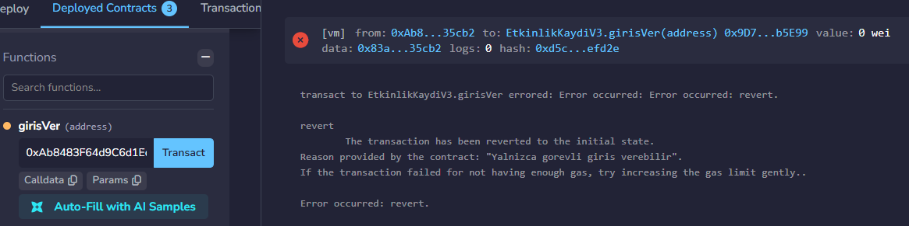

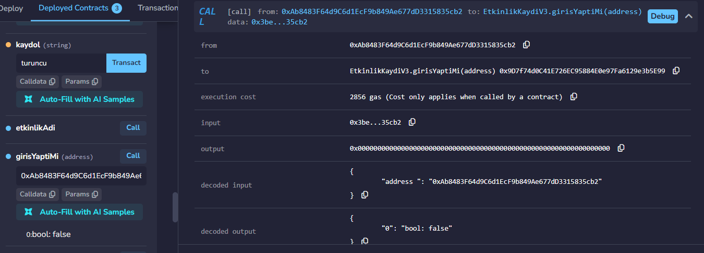

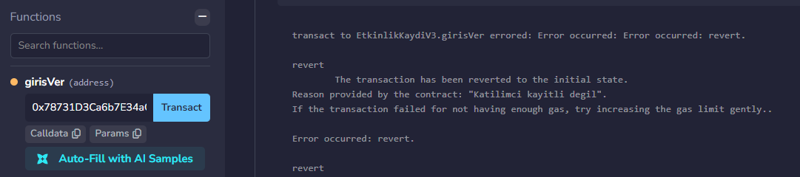

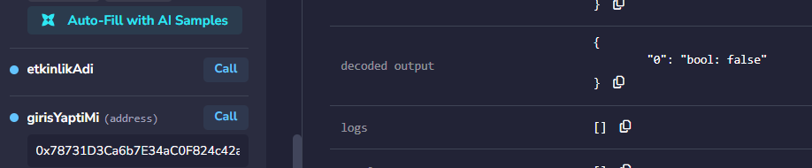

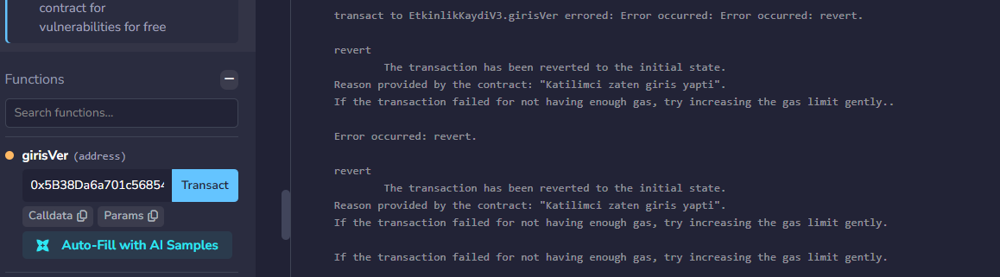

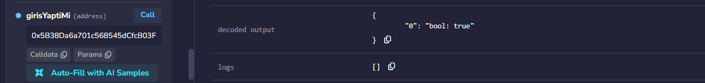

### İP-23 · Etkinlik Sözleşmeni Sepolia’ya Taşı

#### Sepolia dağıtımı

- **Sözleşme.** `EtkinlikKaydiV3`
- **Ağ.** Ethereum Sepolia, zincir kimliği `11155111`
- **Dağıtan hesap.** İlk eğitim hesabım, `0xFD5C85dcffFD489f09a1bCD81B3d0D966D1eba1b`
- **Yeni sözleşme adresi.** `0xf501cdeebdaf0d5e3ef1980f413d94e175c64e8a`
- **Dağıtım işlemi.** `0xe3b80eb47b7e589ccd389514ea11eeba963d216295292557fed5a0bb4eaaaea9`
- **Sonuç.** Etherscan’de `Success` durumu, `12223933` numaralı blok ve `0,009541282595412825 Sepolia ETH` işlem ücreti göründü. [Sepolia Etherscan işlem kaydı](https://sepolia.etherscan.io/tx/0xe3b80eb47b7e589ccd389514ea11eeba963d216295292557fed5a0bb4eaaaea9)

EtkinlikKaydiV3’ün kaynak kodundan oluşturulan [ABI](../src/EtkinlikKaydiV3.abi.json), aşağıdaki kayıt ve giriş olaylarını çözmek için kullanıldı.

#### Derleme ayarları

Remix’in Solidity Compiler panelinde `EtkinlikKaydiV3.sol` açıkken derleyici sürümünü `0.8.34+commit.80d5c536`, EVM hedefini `cancun` ve optimizasyonu kapalı olarak kaydettim. Bu ayarlar Remix ekranından alındı.

#### İlk kayıttan önceki kontroller

- `gorevli()`, dağıtımı yapan ilk eğitim hesabını (`…eba1b`) döndürdü.
- `kapasite()` **3** döndürdü.
- `kayitSayisi()` **0** döndürdü. Sepolia’daki yeni örnek boş başladı. Remix VM’deki kayıtlar bu örneğe taşınmadı.

#### Sepolia’da kayıt ve giriş işlemleri

İkinci eğitim hesabımın (`…E2Ae`) işlemi `12223969` numaralı blokta başarılı oldu. İşlemin dış hedefi `…7dB3` olarak görünse de makbuzdaki `KayitYapildi` olayını bu dağıtımın `…64e8a` adresi yayımladı. Olayın verisinden katılımcının ikinci eğitim hesabı ve takma adın `yesil` olduğunu doğruladım. [Sepolia Etherscan kayıt işlemi](https://sepolia.etherscan.io/tx/0xb4a8a6184083938d1a081934f3d0f9371111fc9d41a562f514ebe1909f33e841)

Remix’in gösterdiği zincir günlüğünde `…64e8a` adresindeki EtkinlikKaydiV3 sözleşmesinin yayımladığı `GirisYapildi(address)` olayını gördüm. Olaydaki katılımcı adresi ikinci eğitim hesabıma (`…E2Ae`) ait. Olay `12223973` numaralı blokta yer alıyor. [Sepolia Etherscan giriş işlemi](https://sepolia.etherscan.io/tx/0x70d6f0ac3e1549db766f2b366d70d06a0c0bd7d97f63d728a84540edf3d7c83b)

#### Sepolia’da kayıt ve giriş durumunu okuma

İlk eğitim hesabım açıkken ikinci eğitim hesabının (`…E2Ae`) adresini iki sorguya da girdim. Sepolia’daki `…64e8a` sözleşmesinde `takmaAdlar` çıktısındaki beş karakter `yesil` olarak çözümlendi. `girisYaptiMi` sorgusu aynı adres için `true` döndürdü.

**Benim yorumum.** Remix’te seçili ağı ve zincir kimliğini, ardından bağlı sözleşme adresini kontrol ederim. Sepolia’da dağıtım işlemini Etherscan’den bulur, `gorevli()` ve `kayitSayisi()` gibi okumalarla doğru örneğe bağlandığımı doğrularım.

## E · Kendi Web Uygulamanı Oluştur

### İP-24 · Cüzdan Bağlantılı Arayüzü Geliştir

[Etkinlik sayfası](../etkinlik/index.html) İP-23’teki Sepolia sözleşmesinden etkinlik adını, kapasiteyi ve toplam kayıt sayısını okur. [Yapılandırmada](../etkinlik/config.js) sözleşme adresi, zincir kimliği ve ABI yolu bulunur. Bağlı adresin takma adı ve giriş durumu cüzdan bölümünde gösterilir. Görevli hesabı seçiliyken katılımcı adresiyle giriş onayı verilebilir.

Tarayıcıda MetaMask bağlantısıyla Sepolia’daki **Quantum Atölyesi** etkinliğini açtım. Uygulama kapasiteyi **3**, toplam kaydı **1** gösterdi. Sayfaya bağlı ikinci eğitim hesabının (`…E2Ae`) takma adı **yesil**, kayıt durumu **Kayıtlı** ve giriş durumu **Giriş onaylandı** olarak göründü.

Kayıtlı hesapta **Kayıt ol** düğmesi pasifti. Henüz kayıt olmamış bir eğitim hesabına geçince düğmenin etkinleştiğini gördüm.

**Benim yorumum.** [app.js](../etkinlik/app.js) içinde `connectWallet`, MetaMask’e `eth_requestAccounts` çağrısı yapar. `refresh`, sözleşmenin okuma fonksiyonlarından etkinlik ve katılımcı bilgilerini alır. `sendTransaction`, seçili hesabı ve ağı doğrular, ABI ile `kaydol` veya `girisVer` çağrısını kodlar ve imzayı MetaMask’ten ister. Başarılı makbuzdan sonra bilgileri tekrar okur. Görevli yetkisi her giriş çağrısında sözleşmede denetlenir.

### İP-25 · Bekleme ve Hata Durumlarını Göster

Arayüz önce **MetaMask onayı bekleniyor** mesajını gösterir. İşlem hash’i geldiğinde Etherscan bağlantısı açılır ve **Sepolia onayı bekleniyor** mesajı görünür. Başarı mesajı, yalnızca işlem makbuzunun durumu `1` olarak okunduğunda gösterilir. Makbuz okunamıyorsa bağlantı korunur. **Bilgileri yenile** düğmesi mevcut hash’in sonucunu ve bağlı hesabın bilgilerini yeniden okur. Uygulama aynı işlemi otomatik olarak tekrar göndermez.

#### Deneme sonuçları

Bu denemeleri arayüz kodunu çalıştırarak, MetaMask ve Sepolia RPC yanıtlarını taklit eden bir ortamda yaptım.

Tarayıcıda gerçek MetaMask bağlantısını, Sepolia okumalarını ve hesap değişiminden sonra kayıt düğmesinin etkinleşmesini doğruladım. İP-25 arayüzündeki başarılı kayıt denemesi simülasyonda yapıldı. Arayüzden canlı kayıt ve görevli giriş onayı henüz denenmedi.

- **Başarılı kayıt.** Önce MetaMask onayı, sonra zincir beklemesi gösterildi. Hash gelince bağlantı göründü. Başarılı makbuz okunduktan sonra kayıt sayısı ve takma ad yenilendi.
- **İmza reddi.** MetaMask ret yanıtı verdiğinde arayüz işlemin gönderilmediğini bildirdi. Başarı mesajı ve yeni işlem bağlantısı oluşmadı.
- **Tekrar kayıt.** Kayıtlı hesapta düğme pasif kaldı ve adresin zaten kayıtlı olduğu açıklandı. Yeni işlem gönderilmedi.
- **Görevli olmayan hesapla giriş.** Giriş paneli gizlendi. Gönderme işlevi doğrudan denendiğinde yetki mesajı gösterildi ve MetaMask’e işlem iletilmedi. Sözleşmenin kendi yetki denetimini İP-22’de Remix VM’de de doğruladım.
- **Hesap değişimi.** Yeni adresin takma adı, kayıt durumu ve görevli paneli otomatik olarak yenilendi.
- **Kapasite dolu.** Kayıtsız hesapta kapasite mesajı göründü ve kayıt düğmesi pasif kaldı.
- **Makbuz alınamadı.** Sonucun doğrulanamadığı yazıldı ve Etherscan bağlantısı korundu. Bilgileri yenileyince aynı hash sorgulandı. Makbuz durumu `0` olan ayrı denemede arayüz işlemin başarısız olduğunu bildirdi.

**Benim yorumum.** Başarısız işlem mesajı, makbuzun işlemin geri alındığını gösterdiği anlamına gelir. Sonucun doğrulanamadığı mesajı, makbuzu henüz okuyamadığım anlamına gelir. Kullanıcı mevcut bağlantıdan işlemi kontrol edebilir ve aynı işlemi gereksiz yere yeniden göndermez.

